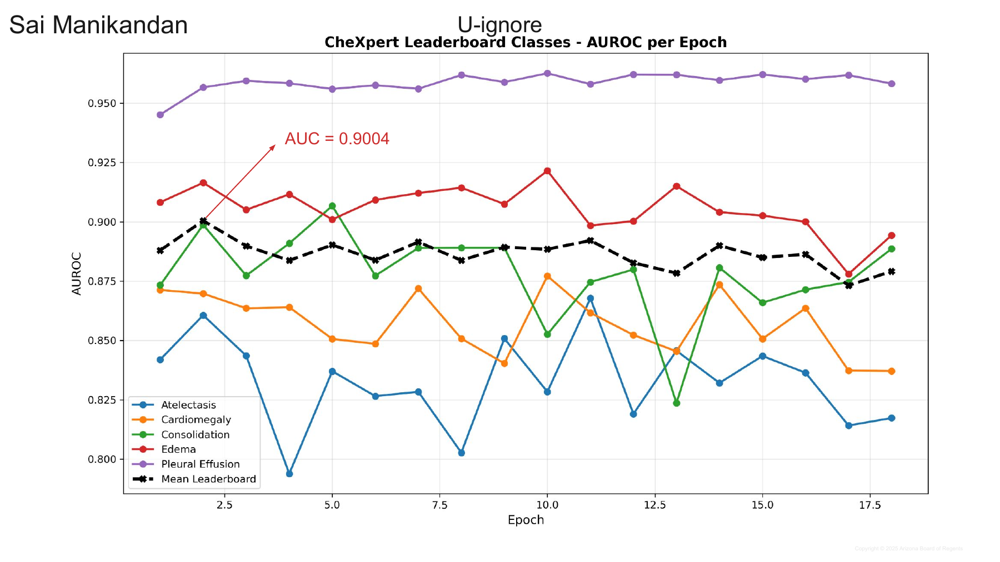
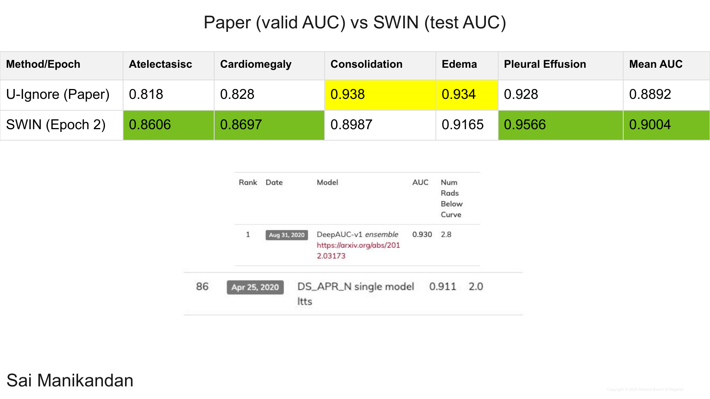
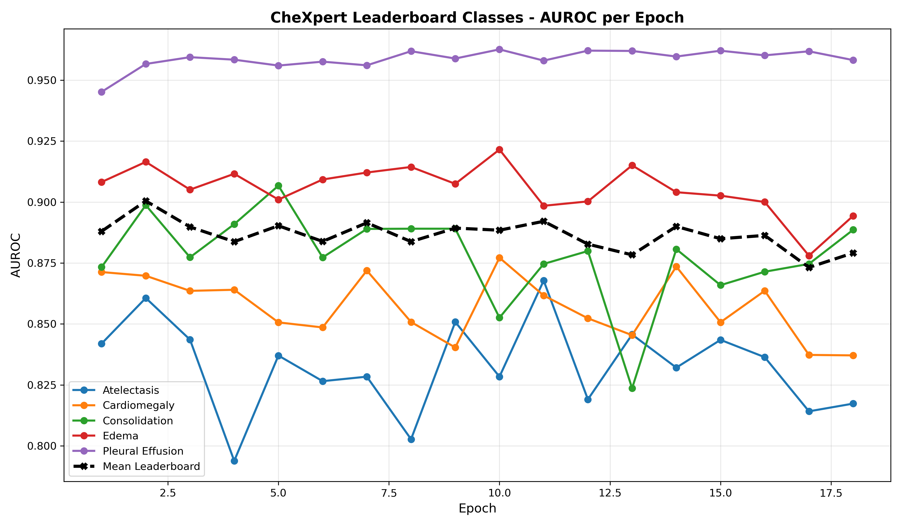
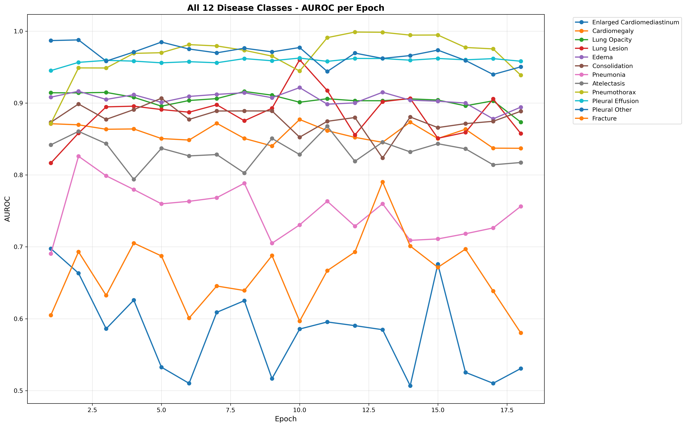
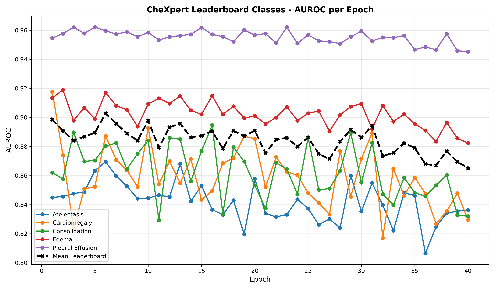

# Results: Swin Transformer on CheXpert

Results extracted from the *Final Presentation* (Sai Manikandan's slides only). Graphs, tables and prediction images come straight from the presentation; every table is also a CSV in [`tables/`](tables/). Statements marked *Observation* are my own reading of a chart or table, not something the slide says.

**Metric reminders:** AUC and Dice: higher is better; loss: lower is better. AP50 / AP75 = average precision at IoU 0.5 / 0.75. FROC score = average sensitivity at up to 1 false positive per image (FPPI).

Folder layout: `slides/` full slides (PNG) · `figures/` original graphs/images (JPEG) · `tables/` CSV.

*Multi-label chest X-ray classification — slides 14–21*

## Setup (slides 15–16)

| Item | Value |
|---|---|
| Task | Multi-label classification of all 14 CheXpert pathologies; mean and per-class AUC reported on the 5 leaderboard pathologies (Atelectasis, Cardiomegaly, Consolidation, Edema, Pleural Effusion) |
| Data | Train 223,414 · validation 234 · test 668 |
| Model | Swin Transformer Base (`swin_base_patch4_window7_224`), ImageNet-1K pretrained, 224×224 input, 14 output logits |
| Training | BCEWithLogitsLoss · AdamW (weight decay 0.1) · learning rate 1e-4 · 18 epochs, best epoch picked by AUC on the 668-image test set (every epoch's checkpoint was scored on it) |
| Uncertain labels | Per class: Cardiomegaly U-Ones (`-1 → 1`), Pleural Effusion U-Zeros (`-1 → 0`), all other classes U-Ignore (masked out of the loss) |
| Best result | Mean 5-class test AUC **0.9004** at epoch 2 |

Slide images: [task & dataset](slides/slide015_exp1_setup_task_dataset.png) · [model & training](slides/slide016_exp1_setup_model_training.png)

**Summary.** The model hit its best mean leaderboard AUC (0.9004) at epoch 2, then stayed between about 0.873 and 0.892 for the remaining
16 epochs. Pleural Effusion is the easiest class (0.945–0.963); Atelectasis is the hardest and least stable (0.794–0.868). Against the
original CheXpert paper's U-Ignore numbers, Swin is higher on mean AUC (+0.011) and on 3 of 5 classes. The run used U-Ignore for
12 of 14 classes but U-Ones / U-Zeros for Cardiomegaly / Pleural Effusion, so this is not a pure U-Ignore comparison.

## 1.1 Training and validation loss (slide 17)

*Original figure: [`exp1_loss_curve.jpg`](figures/exp1_loss_curve.jpg)*

- Training loss falls steadily from 0.5016 (epoch 1) to 0.4794 (epoch 18).
- Validation loss is flat-to-noisy: lowest 0.3654 (epoch 15), highest 0.3842 (epoch 18), rising at epochs 17–18.
- *Observation:* the lowest validation loss (epoch 15) is not the best-AUC epoch (epoch 2). The checkpoint was selected on AUC, not loss.

## 1.2 Loss table (slide 18)

| Epoch | Train loss | Val loss |
|---|---|---|
| 1 | 0.5016 | 0.3822 |
| 2 | 0.4928 | 0.3757 |
| 3 | 0.4899 | 0.3756 |
| 4 | 0.4881 | 0.3817 |
| 5 | 0.4868 | 0.3816 |
| 6 | 0.4856 | 0.375 |
| 7 | 0.4849 | 0.3742 |
| 8 | 0.484 | 0.3718 |
| 9 | 0.4835 | 0.3727 |
| 10 | 0.4834 | 0.3715 |
| 11 | 0.4826 | 0.379 |
| 12 | 0.4826 | 0.3695 |
| 13 | 0.4812 | 0.3698 |
| 14 | 0.4815 | 0.366 |
| 15 | 0.4806 | 0.3654 |
| 16 | 0.4803 | 0.3676 |
| 17 | 0.4796 | 0.3822 |
| 18 | 0.4794 | 0.3842 |

CSV: [`exp1_chexpert_loss.csv`](tables/exp1_chexpert_loss.csv) · slide: [PNG](slides/slide018_exp1_loss_table.png)

## 1.3 Per-class AUROC across epochs (slide 19)

*Original figure (without the "AUC = 0.9004" annotation): [`exp1_auroc_per_epoch.jpg`](figures/exp1_auroc_per_epoch.jpg)*

- Pleural Effusion (purple) is at the top, about 0.96 for nearly every epoch after epoch 2.
- Atelectasis and Consolidation swing the most (Atelectasis 0.7938 at epoch 4; Consolidation 0.8236 at epoch 13) and drive the movement in the mean.
- The mean line is almost flat after the epoch-2 peak (0.9004), so extra epochs gave no net gain.

## 1.4 Per-class AUC table (slide 20)

| Epoch | Cardiomegaly | Edema | Consolidation | Atelectasis | Pleural Effusion | Mean leaderboard AUC |
|---|---|---|---|---|---|---|
| 1 | 0.8713 | 0.9082 | 0.8733 | 0.8419 | 0.9452 | 0.8880 |
| **2** | **0.8697** | **0.9165** | **0.8987** | **0.8606** | **0.9566** | **0.9004** |
| 3 | 0.8636 | 0.9051 | 0.8773 | 0.8436 | 0.9594 | 0.8898 |
| 4 | 0.8640 | 0.9116 | 0.8909 | 0.7938 | 0.9584 | 0.8837 |
| 5 | 0.8506 | 0.9010 | 0.9067 | 0.8370 | 0.9560 | 0.8903 |
| 6 | 0.8486 | 0.9092 | 0.8773 | 0.8265 | 0.9576 | 0.8838 |
| 7 | 0.8719 | 0.9121 | 0.8890 | 0.8284 | 0.9561 | 0.8915 |
| 8 | 0.8508 | 0.9144 | 0.8891 | 0.8027 | 0.9619 | 0.8838 |
| 9 | 0.8403 | 0.9075 | 0.8891 | 0.8508 | 0.9589 | 0.8893 |
| 10 | 0.8771 | 0.9215 | 0.8525 | 0.8284 | 0.9626 | 0.8884 |
| 11 | 0.8617 | 0.8985 | 0.8746 | 0.8678 | 0.9580 | 0.8921 |
| 12 | 0.8523 | 0.9003 | 0.8799 | 0.8190 | 0.9621 | 0.8827 |
| 13 | 0.8454 | 0.9150 | 0.8236 | 0.8457 | 0.9620 | 0.8783 |
| 14 | 0.8735 | 0.9040 | 0.8807 | 0.8321 | 0.9597 | 0.8900 |
| 15 | 0.8507 | 0.9026 | 0.8659 | 0.8435 | 0.9621 | 0.8849 |
| 16 | 0.8636 | 0.9000 | 0.8714 | 0.8364 | 0.9602 | 0.8863 |
| 17 | 0.8373 | 0.8780 | 0.8746 | 0.8141 | 0.9618 | 0.8732 |
| 18 | 0.8371 | 0.8943 | 0.8886 | 0.8173 | 0.9582 | 0.8791 |

CSV: [`exp1_chexpert_auc_per_epoch.csv`](tables/exp1_chexpert_auc_per_epoch.csv) · slide: [PNG](slides/slide020_exp1_auc_table.png)

- Best epoch overall is **epoch 2** (mean 0.9004).
- Per-class peaks in the table: Cardiomegaly 0.8771 (epoch 10), Edema 0.9215 (epoch 10), Consolidation 0.9067 (epoch 5), Atelectasis 0.8678 (epoch 11), Pleural Effusion 0.9626 (epoch 10).
- *Observation:* the slide's green highlight for Edema is on epoch 2 (0.9165), but Edema is higher at epoch 10 (0.9215), so the highlights do not mark every per-class maximum.
- No single epoch is best for every class; the best mean is a compromise across classes.

## 1.5 Comparison with the CheXpert paper and leaderboard (slide 21)

| Method / epoch | Atelectasis | Cardiomegaly | Consolidation | Edema | Pleural Effusion | Mean AUC |
|---|---|---|---|---|---|---|
| U-Ignore (paper, validation AUC) | 0.818 | 0.828 | 0.938 | 0.934 | 0.928 | 0.8892 |
| Swin, epoch 2 (test AUC) | 0.8606 | 0.8697 | 0.8987 | 0.9165 | 0.9566 | 0.9004 |

CSV: [`exp1_chexpert_paper_vs_swin.csv`](tables/exp1_chexpert_paper_vs_swin.csv)

Leaderboard rows shown on the slide for reference: top entry *DeepAUC-v1 ensemble*, AUC 0.930 ([image](figures/exp1_leaderboard_top_entry.jpg)); rank 86 *DS_APR_N* single model, AUC 0.911 ([image](figures/exp1_leaderboard_rank86_entry.jpg)).

- Swin beats the paper on Atelectasis (+0.043), Cardiomegaly (+0.042), Pleural Effusion (+0.029) and mean AUC (+0.0112).
- The paper is higher on Consolidation (0.938 vs 0.8987) and Edema (0.934 vs 0.9165).
- The leaderboard entries (0.930, 0.911) are still above 0.9004.
- *Caveat:* the slide compares the paper's **validation** AUC with Swin's **test** AUC, so the comparison is indicative, not like-for-like.

## 1.6 Run logs and all-class AUROC

The original SLURM logs of this run are in [`run_logs/exp1/`](run_logs/exp1):
- `train.txt` is the training job (Nov 9–10, 2025), with the epoch-by-epoch train and validation loss from table 1.2.
- `test.txt` is the test job (Nov 11, 2025), scoring all 18 checkpoints on the 668-image test set; its AUROCs are table 1.4.

The CSV the test job wrote has per-epoch AUROC for all 14 classes: [`exp1_chexpert_auroc_all_classes_per_epoch.csv`](tables/exp1_chexpert_auroc_all_classes_per_epoch.csv). It is the source of table 1.4.

The test job also drew these two charts. They are the original full-resolution PNGs; the slide figures in 1.3 were taken from them.

*[`exp1_leaderboard_auroc_original.png`](figures/exp1_leaderboard_auroc_original.png): the 5 leaderboard classes and their mean (black dashed) over the 18 epochs.* It is the same data as slide 19, without the slide's annotation:
- The mean peaks at epoch 2 (0.9004) and stays within about 0.87–0.89 afterwards.
- Pleural Effusion sits on top the whole run.
- Atelectasis has the deepest dips (epochs 4 and 8), and Consolidation drops sharply at epochs 10 and 13.

*[`exp1_all_classes_auroc_original.png`](figures/exp1_all_classes_auroc_original.png): every class the test job scored (12 of the 14; `No Finding` and `Support Devices` are not plotted).* This is not in the slides.
- Pneumothorax (up to 0.999 at epoch 12) and Pleural Other (0.94–0.99) score highest.
- Pleural Effusion (0.945–0.963), Lung Opacity (0.873–0.916) and Edema (0.878–0.922) are steady across epochs. Lung Lesion swings widely (0.817–0.960).
- The weakest classes are Pneumonia (0.69–0.83), Fracture (0.58–0.79) and Enlarged Cardiomediastinum (0.51–0.70).
- *Note:* matplotlib's 10-colour cycle repeats here. Enlarged Cardiomediastinum and Pleural Other are both dark blue (lowest and near-top lines), and Cardiomegaly and Fracture are both orange (about 0.85 and the lower orange line).

---

## Supplementary: teacher–student self-training

*Not in the presentation. Run after it (Nov 12–25, 2025) as another way to use the uncertain labels; method in [`../README.md`](../README.md#another-approach-teacherstudent-self-training).*

The reported run's checkpoints act as the teacher. They replace the 138,879 uncertain (`-1`) training labels with pseudo-labels, and a new Swin-B student is trained from ImageNet weights on the result. Every student checkpoint was scored on the same 668-image test set, and the best epoch was picked from those scores, exactly as for the reported run.

| Student | Pseudo-labels (high / low) | Best epoch | Atelectasis | Cardiomegaly | Consolidation | Edema | Pleural Effusion | Mean |
|---|---|---|---|---|---|---|---|---|
| Soft | teacher probability | 3 | 0.8634 | 0.8741 | 0.8979 | 0.9043 | 0.9580 | 0.8995 |
| thresh1 | 0.5 / 0.5 | 3 | 0.8218 | 0.8756 | 0.9004 | 0.9080 | 0.9510 | 0.8914 |
| thresh2 | 0.6 / 0.4 | 4 | 0.8576 | 0.8699 | 0.9138 | 0.9155 | 0.9562 | 0.9026 |
| thresh3 | 0.7 / 0.3 | 7 | 0.8674 | 0.8589 | 0.9121 | 0.9137 | 0.9570 | 0.9018 |
| thresh4 | 0.8 / 0.2 | 4 | 0.8557 | 0.8880 | 0.8893 | 0.9167 | 0.9601 | 0.9020 |
| **thresh5** | **0.9 / 0.1** | **6** | **0.8696** | **0.8872** | **0.8803** | **0.9171** | **0.9596** | **0.9028** |
| Reported run (teacher), epoch 2 | — | 2 | 0.8606 | 0.8697 | 0.8987 | 0.9165 | 0.9566 | 0.9004 |

CSV: [`tables/self_training/summary.csv`](tables/self_training/summary.csv). Per-epoch, all-class CSVs per student are in [`tables/self_training/`](tables/self_training).

*[`self_training_thresh5_leaderboard_auroc.png`](figures/self_training_thresh5_leaderboard_auroc.png): the best student (0.9 / 0.1 pseudo-labels), with the 5 leaderboard classes and their mean over its 40 epochs. Drawn by the test job.*
- The mean peaks at epoch 6 (0.9028), with near-peaks at epochs 1, 10, 13 and 31 (0.894–0.899).
- After epoch 31 the mean drifts down to about 0.865 by epoch 40. Training longer on the pseudo-labels does not help, so the gain comes in the first few epochs, as it did for the teacher.
- Class behaviour matches the teacher: Pleural Effusion stays highest (0.945–0.962), and Atelectasis and Cardiomegaly swing the most.

- Four of the five thresholded students beat the teacher, by +0.0014 to +0.0024. Best is thresh5 (0.9 / 0.1) at 0.9028.
- Soft labels (0.8995) and the 0.5 / 0.5 threshold (0.8914) do not beat it. Turning every pseudo-label into a hard 0 or 1 hurts most, and Atelectasis falls to 0.8218.
- Compared with the teacher, thresh5 gains on Cardiomegaly (+0.0175), Atelectasis (+0.0090) and Pleural Effusion (+0.0030) but loses on Consolidation (−0.0184), so its mean gain is small.
- *Caveat:* the gains are within the epoch-to-epoch swing of the reported run (0.873–0.900), and the epochs were picked on the test set. They suggest confident pseudo-labels help a little; they do not prove it.

Original logs in [`run_logs/self_training/`](run_logs/self_training):

| Log | What it shows |
|---|---|
| `swin_predict_teacher_39019568.out` | Soft pseudo-label generation (`teacher_predict.py`, thresholding off) |
| `swin_predict_teacher_multi_40177597.out` | Thresholded pseudo-labels for the 5 threshold pairs (`teacher_predict_multi.py`) |
| `swin_train_student_39049336_*.out` | Soft-label student training |
| `thresh1/` … `thresh5/` | Student training per threshold (one file per 10-epoch job) |
| `test/swin_test_39113703.out`, `test/thresh1/` … `test/thresh5/` | Test-set AUROC of every student checkpoint |

---

**Corrections to the original write-up.** Checked against the training code that produced these numbers
([`../exp1_policy_training/`](../exp1_policy_training)). No numbers were changed.
- Uncertain labels: the slides say U-Ignore; the code uses U-Ones for Cardiomegaly, U-Zeros for Pleural Effusion and U-Ignore (masking) for the other 12 classes.
- Epoch selection: the best epoch was chosen on test-set AUC, not on a separate validation set.

---

*Source: "Final Presentation" (Arizona Board of Regents, 2025). Tables were transcribed from the slide text and cross-checked against the rendered slides; the images are the slides themselves or the figures embedded in them.*
