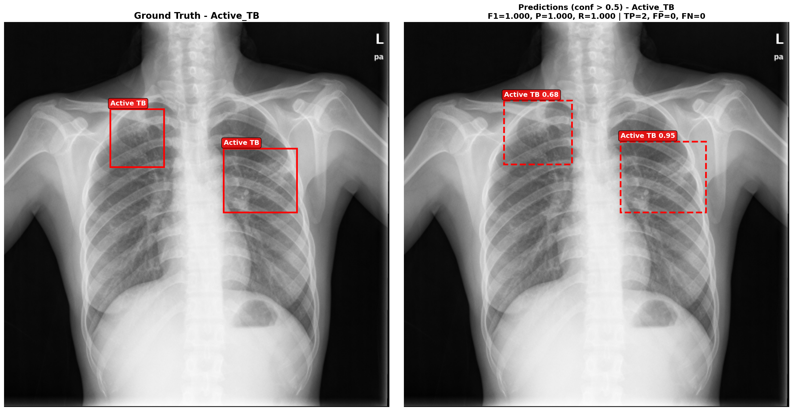
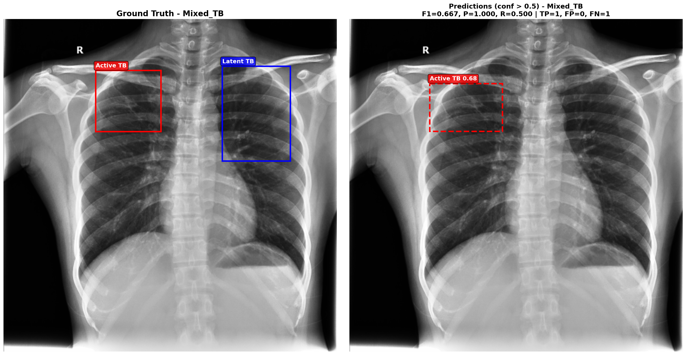
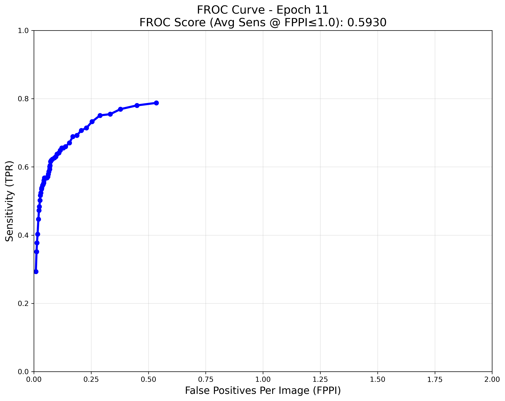
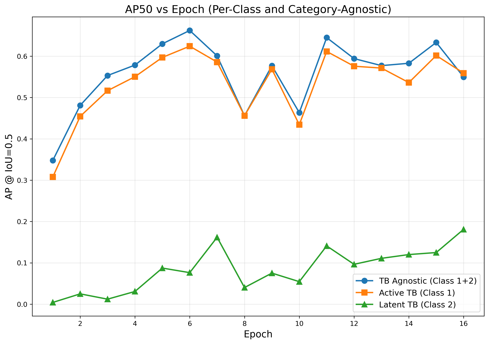

# TBX11K-TB-Localization: Tuberculosis Lesion Detection with Swin Transformer FPN & Stratified Splitting

[](https://pytorch.org/)
[](https://github.com/microsoft/Swin-Transformer)
[](../LICENSE)

An accessible, self-contained deep learning pipeline for **pulmonary tuberculosis bounding box localization and lesion subtyping** on the **TBX11K** benchmark, featuring **stratified 4-category dataset splitting** and **class-agnostic lesion detection evaluation**.

---

## Key Highlights

1. **Simplified Tabular Workflow**: Directly processes tabular CSV annotations (`data.csv`) with dictionary-encoded bounding boxes, removing the requirement to convert to complex COCO/Pascal VOC formats.
2. **Clinical Stratification Scheme**: Solves sample imbalance and lesion co-occurrence by partitioning radiographs across 4 diagnostic disease categories:
   * **`No_TB`**: Healthy / non-tuberculous control radiographs.
   * **`Active_TB`**: Manifests exclusively active tuberculosis lesions.
   * **`Latent_TB`**: Manifests exclusively obsolete / latent tuberculosis calcifications.
   * **`Mixed_TB`**: Complex presentations containing *both* active and obsolete lesions in the same patient.
3. **Comprehensive Metric Suite**: Computes standard AP50 and AP75, alongside **class-agnostic TB detection** (measuring the model's ability to localize any TB abnormality regardless of exact sub-classification).

---

## Results

Faster R-CNN, Swin-B + FPN, 512×512, AdamW (lr 1e-4), batch 8, 16 epochs, custom stratified split (train 4,622 · val 1,800 · test 1,977).

| Epoch | AP50 agnostic | AP50 Active | AP50 Latent | AP75 agnostic | FROC |
| :--- | :--- | :--- | :--- | :--- | :--- |
| 6 (best AP50) | **0.6622** | **0.6241** | 0.0763 | 0.1059 | 0.4991 |
| 11 (best FROC) | 0.6449 | 0.6114 | **0.1410** | 0.1239 | **0.5930** |
| 15 (best AP75) | 0.6332 | 0.6016 | 0.1249 | **0.1905** | 0.5817 |

Active TB is detected well; Latent TB (73 training images) stays weak.

### Prediction examples (epoch 11, test set)

Ground truth on the left and predictions (confidence > 0.5) on the right; red = Active TB, blue = Latent TB.

<p align="center">
  
  
</p>

- **Left:** both Active TB lesions found (confidence 0.95 and 0.68), F1 1.0.
- **Right:** a Mixed TB image. The active lesion is found, but the latent one is missed.

Five more examples with descriptions, including failure cases (boxes too small, latent lesions labelled as active), and FROC curves for every epoch: [`results/README.md`](results/README.md#210-prediction-examples-epoch-11).

The exact scripts that produced these numbers are in [`original_run/`](original_run). Their SLURM training and test logs, and the metrics for all 16 epochs, are in [`results/run_logs/`](results/run_logs) and [`results/README.md`](results/README.md#28-run-logs-and-every-epochs-metrics).

<p align="center">
  
  
</p>

Loss, AP75, FROC-per-epoch, leaderboard reference and slides: [`results/README.md`](results/README.md).

---

## Model Architecture

```
Input CXR (512 x 512)
          │
          ▼
┌────────────────────────────────────────────────────────┐
│  Swin Transformer Base (timm)                          │
│  - Stage 1 (H/8, W/8): 256 channels                    │
│  - Stage 2 (H/16, W/16): 512 channels                  │
│  - Stage 3 (H/32, W/32): 1024 channels                 │
└────────────────────────────────────────────────────────┘
          │
          ▼
┌────────────────────────────────────────────────────────┐
│  Feature Pyramid Network (Torchvision FPN)             │
│  - Lateral Conv2d (256, 512, 1024 -> 256)              │
│  - Top-Down pathway with LastLevelMaxPool              │
│  - 4 Output scales: ['0', '1', '2', '3']               │
└────────────────────────────────────────────────────────┘
          │
          ▼
┌────────────────────────────────────────────────────────┐
│  Faster R-CNN Detection Head                           │
│  - Anchor sizes: (32, 64, 128, 256)                    │
│  - 3-Class Classifier: Background, Active TB, Latent TB│
│  - Smooth L1 Box Regressor                             │
└────────────────────────────────────────────────────────┘
```

---

## Repository Structure

```
02_detection/
├── models/
│   ├── __init__.py
│   └── swin_fpn.py           # SwinBackboneWithFPN and Faster R-CNN builder
├── data/
│   ├── __init__.py
│   ├── dataset.py            # Tabular TBX11K Dataset & collation
│   ├── split_dataset.py      # Stratified 4-category split generator
│   └── analyze_dataset.py    # Split and bounding-box distribution auditor
├── original_run/             # Exact scripts of the reported run (hardcoded ASU Sol paths)
│   ├── train.py / train.sh   # Training
│   ├── test.py / test.sh     # Scores every checkpoint: per-epoch CSV, AP/FROC plots
│   └── min_max_predict.py/.sh  # Best/worst test images per category
├── scripts/
│   └── train_slurm.sh        # SLURM script (ASU Sol-specific)
├── train.py                  # Training pipeline with checkpoint resumption
├── evaluate.py               # AP50, AP75, class-specific & class-agnostic eval
├── visualize.py              # Side-by-side Ground Truth vs Prediction visualizer
├── results/                  # Reported tables, figures, slides and original run logs
├── requirements.txt
└── README.md
```

---

## Installation

```bash
git clone https://github.com/smanika3/Swin-CXR-Suite.git
cd Swin-CXR-Suite/02_detection

conda create -n tb_localization python=3.9 -y
conda activate tb_localization

pip install -r requirements.txt
```

All commands below are run from inside `02_detection/` (the scripts import the local `models/` and `data/` packages).

---

## Dataset

We use the simplified TBX11K release from Kaggle: <https://www.kaggle.com/datasets/usmanshams/tbx-11>. Expected layout:
```
tbx11k-simplified/
├── data.csv
└── images/          # chest X-rays referenced by data.csv `fname`
```

`data.csv` has one row per bounding box (images without boxes have a single row). The code reads these columns:

| Column | Content |
| :--- | :--- |
| `fname` | Image file name inside `images/` |
| `bbox` | `none`, or a dict string `{'xmin': ..., 'ymin': ..., 'width': ..., 'height': ...}` in pixel coordinates of the 512×512 images |
| `tb_type` | `active_tb`, `latent_tb`, or `none` (a box with any other value gets label 0) |
| `source` | `train` or `val` (official TBX11K split) |

Each image is assigned a category from the set of its `tb_type` values: `No_TB` (only `none`), `Active_TB` (active, no latent), `Latent_TB` (latent, no active), `Mixed_TB` (both); anything else is `Unknown`. Boxes with `tb_type` `active_tb` → class 1, `latent_tb` → class 2.

---

## Data Preparation & Stratification

### 1. Generate Splits
```bash
python data/split_dataset.py \
    --csv-path /path/to/tbx11k-simplified/data.csv \
    --output-dir /path/to/tbx11k-simplified
```
Writes `train.txt`, `val.txt`, `test.txt` (one image path per line, prefixed with `--img-dir`, default `<csv dir>/images`). Seed 42 (`--seed`).

* **val** = all `source == val` images, i.e. the official TBX11K validation set (1,800 images).
* **test** = carved from the `source == train` images per category: `int(0.3 × n)` images, with at least 20 `Latent_TB` and 5 `Mixed_TB`.
* **train** = the remaining `source == train` images. `Unknown` images from `source == train` are not used.

Resulting split (train 4,622 · val 1,800 · test 1,977):

| Category (`source == train`) | Total | Train | Test |
| :--- | :--- | :--- | :--- |
| No_TB | 6,000 | 4,200 | 1,800 |
| Active_TB | 473 | 332 | 141 |
| Latent_TB | 103 | 73 | 30 |
| Mixed_TB | 23 | 17 | 6 |

### 2. Verify Split Distributions
```bash
python data/analyze_dataset.py \
    --csv-path /path/to/data.csv \
    --splits-dir /path/to/tbx11k-simplified
```

---

## Training

Train the Faster R-CNN detector:
```bash
python train.py \
    --data-dir /path/to/tbx11k-simplified \
    --checkpoint-dir ./checkpoints \
    --epochs 30 \
    --batch-size 8 \
    --lr 1e-4 \
    --img-size 512
```

Optimizer: AdamW (lr 1e-4), no LR schedule. Train and validation loss are printed every epoch and stored in each checkpoint. To resume from the latest saved checkpoint, append `--resume`.

On ASU Sol: `mkdir -p logs && sbatch scripts/train_slurm.sh` (from `02_detection/`). The script's partition/qos, modules and conda env name (`swin_pytorch_env`) are Sol-specific.

---

## Evaluation & Metrics

Evaluate the test set across multiple IoU thresholds:
```bash
python evaluate.py \
    --data-dir /path/to/tbx11k-simplified \
    --checkpoint ./checkpoints/checkpoint_epoch_30.pth \
    --split test
```

### Output Metric Matrix
* **Active TB AP@0.50 & AP@0.75**: Performance on cavitary, infiltrate, and active tuberculous consolidation.
* **Latent TB AP@0.50 & AP@0.75**: Performance on calcified nodules, fibrotic bands, and apical scarring.
* **Class-Agnostic AP**: Overall lesion localization ability independent of subtype diagnosis.
* **FROC score**: Mean lesion sensitivity over FROC points with up to 1 false positive per image (curve swept over 50 score thresholds, FPPI capped at 2.0).

---

## Side-by-Side Qualitative Visualizer

Generate visual comparisons highlighting Ground Truth vs Predicted bounding boxes:
```bash
python visualize.py \
    --data-dir /path/to/tbx11k-simplified \
    --checkpoint ./checkpoints/checkpoint_epoch_30.pth \
    --num-samples 10 \
    --score-thresh 0.3 \
    --output-dir ./visualizations
```

---

## Citation

```bibtex
@article{liu2021swin,
  title={Swin transformer: Hierarchical vision transformer using shifted windows},
  author={Liu, Ze and Lin, Yutong and Cao, Yue and Hu, Han and Wei, Yixuan and Zhang, Zheng and Lin, Stephen and Guo, Baining},
  journal={ICCV},
  year={2021}
}
```
