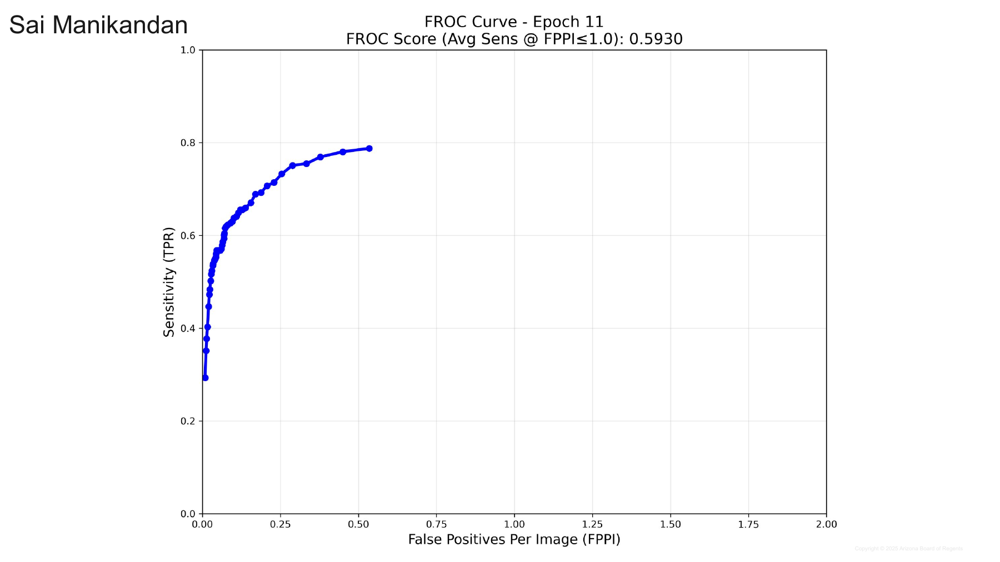
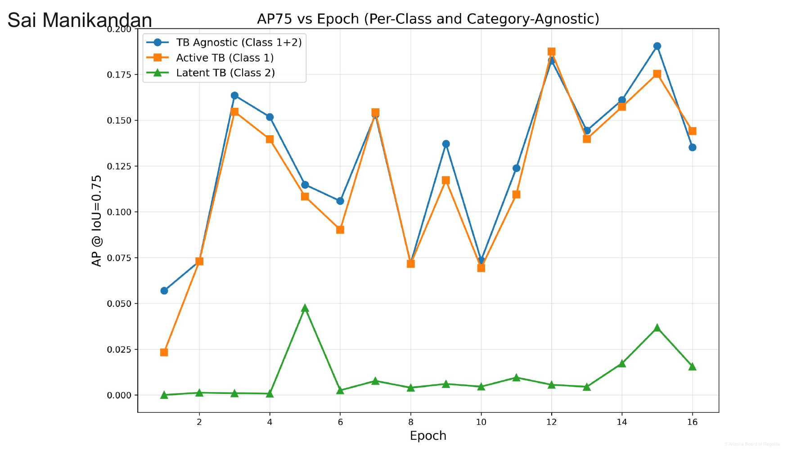
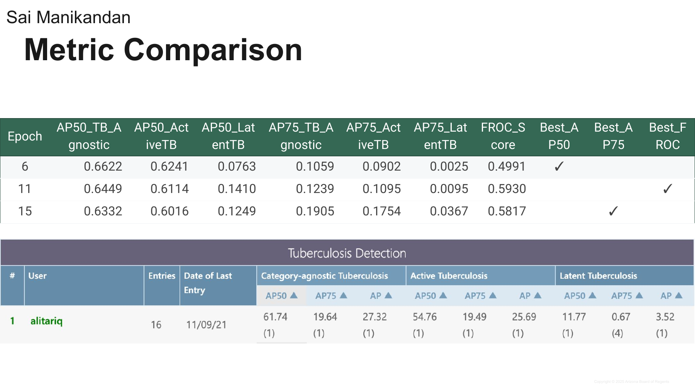

# Results: Swin + Faster R-CNN on TBX11K

Results extracted from the *Final Presentation* (Sai Manikandan's slides only). Graphs, tables and prediction images come straight from the presentation; every table is also a CSV in [`tables/`](tables/). Statements marked *Observation* are my own reading of a chart or table, not something the slide says.

**Metric reminders:** AUC and Dice: higher is better; loss: lower is better. AP50 / AP75 = average precision at IoU 0.5 / 0.75. FROC score = average sensitivity at up to 1 false positive per image (FPPI).

Folder layout: `slides/` full slides (PNG) · `figures/` original graphs/images (JPEG) · `tables/` CSV.

*Tuberculosis lesion detection — slides 55–64*

## Setup (slides 56–57)

| Item | Value |
|---|---|
| Task | Object detection (localisation) of tuberculosis lesions in chest X-rays; images fall in 4 categories: No_TB, Active_TB, Latent_TB, Mixed_TB |
| Split | Stratified split; minimum quotas for rare classes in the test set (at least 20 Latent_TB and 5 Mixed_TB). Train 4,622 · Val 1,800 · Test 1,977 |
| Model | Faster R-CNN, Swin Base backbone (ImageNet pretrained, features from stages 1–3), FPN with 256 output channels |
| RPN | Anchor sizes 32/64/128/256 px; aspect ratios 0.5/1.0/2.0 |
| Heads / input | 3 classes (background, Active TB, Latent TB); images resized to 512×512 |
| Training | AdamW · learning rate 1e-4 · batch size 8 · multi-task loss (RPN classification + regression, ROI classification + regression) · 30 epochs listed on slide 57 (result slides report 16) |
| Thresholds | Training proposal 0.05 · inference confidence 0.5 · IoU 0.5 |
| Best result | FROC score **0.5930** at epoch 11 |

Dataset split by category (slide 56):

| Category | Total | Train | Test |
|---|---|---|---|
| No_TB | 6000 | 4200 (70.0%) | 1800 (30.0%) |
| Active_TB | 473 | 332 (70.2%) | 141 (29.8%) |
| Latent_TB | 103 | 73 (70.9%) | 30 (29.1%) |
| Mixed_TB | 23 | 17 (73.9%) | 6 (26.1%) |

CSV: [`exp2_tbx11k_dataset_split.csv`](tables/exp2_tbx11k_dataset_split.csv)

Slide images: [task & dataset](slides/slide056_exp2_setup_task_dataset.png) · [model & training](slides/slide057_exp2_setup_model_training.png)

**Summary.** The detector localises **Active TB** well (AP50 about 0.60–0.62 at its best epochs) but struggles with **Latent TB**
(AP50 only 0.08–0.14 at the three standout epochs, AP75 near zero), the rare class. Metrics peak at different epochs: AP50 at epoch 6,
FROC at epoch 11, AP75 at epoch 15. Epoch 11 is the headline because it has the best FROC score. Validation loss rises after epoch 14, a sign of overfitting.

## 2.1 Training and validation loss (slide 58)

*Original figure: [`exp2_loss_curve.jpg`](figures/exp2_loss_curve.jpg)*

- Training loss falls from 0.0315 to about 0.008–0.009, with a visible drop at epoch 11.
- Validation loss is noisy and lowest at epoch 11 (0.0183), then jumps to 0.0287 (epoch 15) and 0.028 (epoch 16).
- *Observation:* training loss keeps improving while validation loss worsens at the end, i.e. overfitting after epoch 14.

## 2.2 Loss table (slide 59)

| Epoch | Train loss | Val loss |
|---|---|---|
| 1 | 0.0315 | 0.0211 |
| 2 | 0.0208 | 0.0247 |
| 3 | 0.0207 | 0.0213 |
| 4 | 0.0172 | 0.0252 |
| 5 | 0.0156 | 0.0192 |
| 6 | 0.0145 | 0.0191 |
| 7 | 0.0156 | 0.0228 |
| 8 | 0.0141 | 0.0226 |
| 9 | 0.0148 | 0.0216 |
| 10 | 0.0143 | 0.0225 |
| **11** | **0.01** | **0.0183** |
| 12 | 0.01 | 0.019 |
| 13 | 0.0097 | 0.0196 |
| 14 | 0.0079 | 0.0195 |
| 15 | 0.0082 | 0.0287 |
| 16 | 0.0093 | 0.028 |

Epoch 11 (bold; highlighted yellow on the slide) has the lowest validation loss. CSV: [`exp2_tbx11k_loss.csv`](tables/exp2_tbx11k_loss.csv) · slide: [PNG](slides/slide059_exp2_loss_table.png)

## 2.3 FROC score vs epoch (slide 60)

*Original figure: [`exp2_froc_vs_epoch.jpg`](figures/exp2_froc_vs_epoch.jpg)*

- FROC rises from 0.24 (epoch 1) to about 0.55 by epoch 5, then oscillates between roughly 0.42 and 0.59.
- Best: **0.5930 at epoch 11**; second best 0.5817 at epoch 15.
- The large epoch-to-epoch swings mean no single epoch should be read as a stable level.

## 2.4 FROC curve at the best epoch (slide 61)

*Original figure: [`exp2_froc_curve_epoch11.jpg`](figures/exp2_froc_curve_epoch11.jpg)*

- Sensitivity climbs steeply at low false-positive rates: about 0.6 at roughly 0.07 FPPI and about 0.75 at roughly 0.3 FPPI (read from the chart).
- The plotted curve ends at about 0.79 sensitivity near 0.53 FPPI; the x-axis extends to 2.0 but no points are plotted beyond that.
- FROC score = average sensitivity up to FPPI 1.0 = **0.5930**.

## 2.5 AP50 vs epoch (slide 62)

*Original figure: [`exp2_ap50_vs_epoch.jpg`](figures/exp2_ap50_vs_epoch.jpg)*

- Category-agnostic and Active TB track each other and peak at epoch 6 (0.6622 and 0.6241), with sharp dips at epochs 8 and 10.
- Latent TB stays far lower (0.004–0.18 across epochs; 0.0763 at epoch 6, 0.1410 at epoch 11), trending up late in training.
- *Observation:* the Active-vs-Latent gap is the main weakness. Latent TB has only 73 training images vs 332 for Active TB (slide 56).

## 2.6 AP75 vs epoch (slide 63)

*Original figure: [`exp2_ap75_vs_epoch.jpg`](figures/exp2_ap75_vs_epoch.jpg)*

- AP75 is much lower than AP50 (best about 0.19 vs 0.66): objects are found but boxes are often not tightly placed.
- Category-agnostic AP75 peaks at epoch 15 (0.1905); Active TB peaks around epoch 12 (about 0.19) and is 0.1754 at epoch 15.
- Latent TB AP75 is close to zero throughout (max about 0.047 at epoch 5).

## 2.7 Metric comparison at the best epochs (slide 64)

| Epoch | AP50 TB-agnostic | AP50 Active TB | AP50 Latent TB | AP75 TB-agnostic | AP75 Active TB | AP75 Latent TB | FROC score | Best AP50 | Best AP75 | Best FROC |
|---|---|---|---|---|---|---|---|---|---|---|
| 6 | 0.6622 | 0.6241 | 0.0763 | 0.1059 | 0.0902 | 0.0025 | 0.4991 | yes |  |  |
| **11** | **0.6449** | **0.6114** | **0.1410** | **0.1239** | **0.1095** | **0.0095** | **0.5930** |  |  | **yes** |
| 15 | 0.6332 | 0.6016 | 0.1249 | 0.1905 | 0.1754 | 0.0367 | 0.5817 |  | yes |  |

CSV: [`exp2_tbx11k_metrics_best_epochs.csv`](tables/exp2_tbx11k_metrics_best_epochs.csv)

Leaderboard reference row shown on the slide (TBX11K Tuberculosis Detection, values in %; [image](figures/exp2_leaderboard_reference.jpg)):

| Reference (leaderboard row on slide 64) | Cat-agnostic AP50 | Cat-agnostic AP75 | Cat-agnostic AP | Active AP50 | Active AP75 | Active AP | Latent AP50 | Latent AP75 | Latent AP |
|---|---|---|---|---|---|---|---|---|---|
| alitariq (rank 1, 16 entries, 11/09/21) | 61.74 | 19.64 | 27.32 | 54.76 | 19.49 | 25.69 | 11.77 | 0.67 | 3.52 |

CSV: [`exp2_tbx11k_leaderboard_reference.csv`](tables/exp2_tbx11k_leaderboard_reference.csv)

- **Epoch 6** is best for AP50 (agnostic 0.6622, Active 0.6241, Latent 0.0763; FROC 0.4991).
- **Epoch 11** is best for FROC: 0.5930.
- **Epoch 15** is best for AP75 (agnostic 0.1905, Active 0.1754, Latent 0.0367; FROC 0.5817).
- *Observation:* in percent, the epoch-6 AP50 values (66.22 agnostic, 62.41 Active) are above the leaderboard row (61.74, 54.76), epoch-11 Latent AP50 (14.10) is above 11.77, and epoch-15 agnostic AP75 (19.05) is just below 19.64. This is indicative only: the slide uses a custom train/test split, not the official benchmark split.

---

*Source: "Final Presentation" (Arizona Board of Regents, 2025). Tables were transcribed from the slide text and cross-checked against the rendered slides; the images are the slides themselves or the figures embedded in them.*
