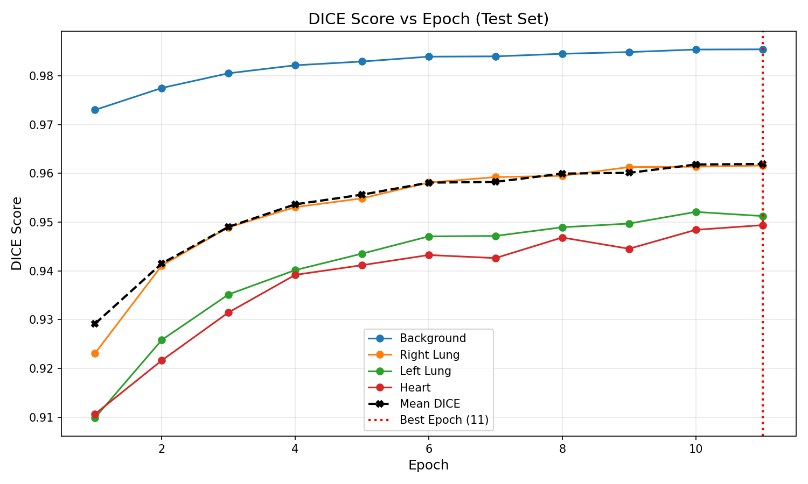
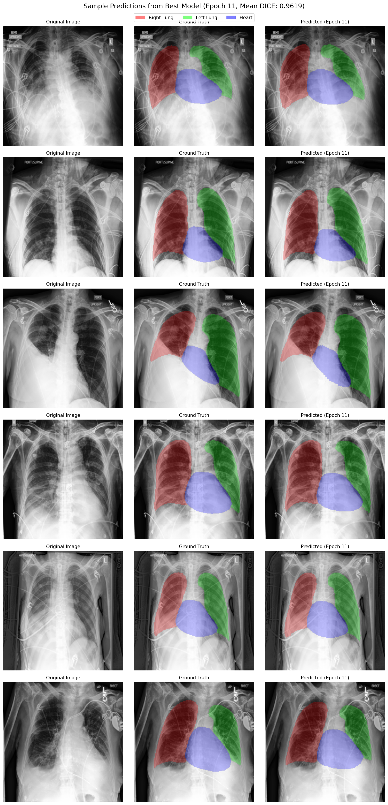

# CheXmask-Swin-Unet: Anatomical Semantic Segmentation of Lungs & Heart

[](https://pytorch.org/)
[](https://github.com/HuCaoFighting/Swin-Unet)
[](../LICENSE)

An end-to-end deep learning framework for **pixel-level multi-organ anatomical semantic segmentation** on chest radiographs (CXRs), trained on the **CheXmask** database using **Swin-Unet-V2**.

---

## Overview

Accurate boundary segmentation of cardiothoracic structures is fundamental for automated cardiomegaly assessment (cardiothoracic ratio), lung disease quantification, and spatial conditioning.

### Target Anatomical Classes
* **Class 0**: Background
* **Class 1**: Right Lung
* **Class 2**: Left Lung
* **Class 3**: Heart

---

## Quantitative Results & Training Dynamics

Best checkpoint: epoch 11 of 11, CheXmask test set (55,978 images).

| Anatomical Structure | Test Dice Coefficient |
| :--- | :--- |
| **Background** | 0.9854 |
| **Right Lung** | 0.9616 |
| **Left Lung** | 0.9512 |
| **Heart** | 0.9494 |
| **Mean Dice** | **0.9619** |

Per-epoch Dice and loss tables, best/worst test cases and the setup are in [`../results/README.md#3-swin-u-net-v2-on-chexmask`](../results/README.md#3-swin-u-net-v2-on-chexmask).

<p align="center">
  
  
</p>

### Qualitative Predictions

<p align="center">
  
</p>

---

## Model Architecture

```
Input CXR (224 x 224 x 3)
           │
           ▼
┌──────────────────────────────────────────────┐
│  Swin-Unet Encoder (Swin Transformer Blocks) │
│  - Patch Partition: 4x4 patches              │
│  - Stage 1: Linear Embedding -> Swin Blocks  │
│  - Stage 2: Patch Merging (H/8, W/8, 2C)     │
│  - Stage 3: Patch Merging (H/16, W/16, 4C)   │
│  - Stage 4: Patch Merging (H/32, W/32, 8C)   │
└──────────────────────────────────────────────┘
           │
      Skip │ Connections
           ▼
┌──────────────────────────────────────────────┐
│  Swin-Unet Decoder (Patch Expanding)         │
│  - Patch Expanding: 2x upsampling            │
│  - Skip concatenation with encoder features  │
│  - Shifted-window cross-attention            │
└──────────────────────────────────────────────┘
           │
           ▼
┌──────────────────────────────────────────────┐
│  Segmentation Head (Conv2d 1x1 -> 4 Classes) │
│  [Background, Right Lung, Left Lung, Heart]  │
└──────────────────────────────────────────────┘
```

---

## Repository Structure

```
chexmask-swin-unet/
├── models/
│   ├── __init__.py
│   ├── swin_unet_v2.py          # Swin-Unet-V2 architecture implementation
│   └── vision_transformer.py    # Transformer building blocks
├── data/
│   ├── __init__.py
│   ├── prep_mask.py             # Parallel RLE string decoder to PNG masks
│   └── dataset.py               # PyTorch CheXmask dataset loader
├── analysis/
│   ├── __init__.py
│   └── min_max_analysis.py      # Audits and plots best & worst predictions
├── assets/                      # Evaluation curves and sample predictions
├── scripts/
│   └── train_slurm.sh           # HPC batch submission script
├── train.py                     # Multi-GPU training pipeline
├── evaluate.py                  # Test set Dice evaluation suite
├── requirements.txt
├── .gitignore
└── README.md
```

---

## Installation & Setup

```bash
git clone https://github.com/<your-username>/chexmask-swin-unet.git
cd chexmask-swin-unet

conda create -n chexmask_env python=3.9 -y
conda activate chexmask_env

pip install -r requirements.txt
```

---

## Data Preparation

1. Download CheXpert images and the **CheXmask** CSV (`chexmask.csv`).
2. Run the high-throughput parallel decoder to unpack RLE annotations into multi-class PNGs:
   ```bash
   python data/prep_mask.py \
       --csv-path /path/to/chexmask.csv \
       --train-img-dir /path/to/chexpert/train \
       --val-img-dir /path/to/chexpert/valid \
       --output-dir /path/to/chexmask-masks \
       --num-workers 16
   ```

---

## Training

Launch model training with automatic mixed precision (AMP) and validation checkpoints:
```bash
python train.py \
    --img-dir /path/to/chexpert/train \
    --mask-dir /path/to/chexmask-masks/train \
    --train-list /path/to/chexmask-masks/train_files.txt \
    --val-list /path/to/chexmask-masks/valid_files.txt \
    --checkpoint-dir ./checkpoints \
    --epochs 40 \
    --batch-size 32 \
    --lr 1e-4
```

To resume training from an interrupted checkpoint, add the `--resume` flag.

---

## Evaluation & Error Analysis

### 1. Test Set Evaluation
```bash
python evaluate.py \
    --img-dir /path/to/chexpert/train \
    --mask-dir /path/to/chexmask-masks/train \
    --test-list /path/to/chexmask-masks/test_files.txt \
    --checkpoint ./checkpoints/best_model.pth
```

### 2. Clinical Failure & Edge Case Analysis
To diagnose model limitations (e.g., severe pleural effusion obscuring lung bases, cardiomegaly boundary bleeding), run:
```bash
python analysis/min_max_analysis.py \
    --img-dir /path/to/chexpert/train \
    --mask-dir /path/to/chexmask-masks/train \
    --test-list /path/to/chexmask-masks/test_files.txt \
    --checkpoint ./checkpoints/best_model.pth \
    --output-dir ./analysis_results
```

---

## Citation & Acknowledgments

```bibtex
@article{cao2022swin,
  title={Swin-unet: Unet-like pure transformer for medical image segmentation},
  author={Cao, Hu and Wang, Yueyue and Chen, Joy and Jiang, Dongsheng and Zhang, Xiaopeng and Tian, Qi and Wang, Manning},
  journal={ECCV},
  year={2022}
}

@article{chexmask2023,
  title={CheXmask: Anatomical Segmentation for CheXpert Chest Radiographs},
  journal={PhysioNet},
  year={2023}
}
```
