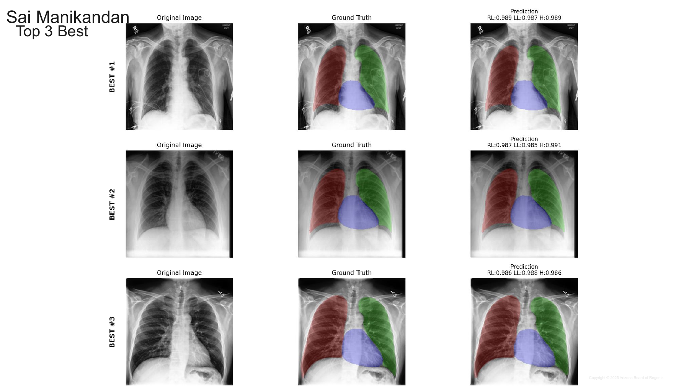

# Results: Swin U-Net V2 on CheXmask

Results extracted from the *Final Presentation* (Sai Manikandan's slides only). Graphs, tables and prediction images come straight from the presentation; every table is also a CSV in [`tables/`](tables/). Statements marked *Observation* are my own reading of a chart or table, not something the slide says.

**Metric reminders:** AUC and Dice: higher is better; loss: lower is better. AP50 / AP75 = average precision at IoU 0.5 / 0.75. FROC score = average sensitivity at up to 1 false positive per image (FPPI).

Folder layout: `slides/` full slides (PNG) · `figures/` original graphs/images (JPEG) · `tables/` CSV.

*Lung and heart segmentation (CheXpert images) — slides 84–94*

## Setup (slides 85–88)

| Item | Value |
|---|---|
| Task | 4-class segmentation: background, right lung, left lung, heart |
| Data | CheXmask annotations on the CheXpert train set (~186,592 images; masks filtered with RCA for quality). Custom patient-independent 70/30 split (scikit-learn, `random_state=42`): train 130,614 · test 55,978. Validation: 199 images from the original CheXpert validation set |
| Preprocessing | RLE-compressed masks decoded to PNG at 224×224; grayscale X-rays resized to 224×224 |
| Model | Swin Transformer U-Net V2: hierarchical Swin encoder with a U-Net-style decoder and skip connections. `img_size=224`, `num_classes=4`, `depths=[2,2,2,2]`, `depths_decoder=[1,2,2,2]`, `drop_path_rate=0.1` |
| Training | AdamW · learning rate 1e-4 · weight decay 0.05 · CrossEntropyLoss |
| Best result | Mean Dice **0.9619** at epoch 11 (background 0.9854, right lung 0.9616, left lung 0.9512, heart 0.9494) |

Slide images: [dataset](slides/slide085_exp3_setup_dataset.png) · [preprocessing](slides/slide086_exp3_setup_preprocessing.png) · [model](slides/slide087_exp3_setup_model.png) · [training](slides/slide088_exp3_setup_training.png)

**Summary.** Segmentation improved every epoch of the 11-epoch run, finishing at mean Dice 0.9619. Background is near-perfect (0.9854), then
right lung (0.9616), with left lung (0.9512) and heart (0.9494) slightly harder. The best three test images match ground truth almost exactly
(per-class Dice 0.985–0.991); the worst three (mean Dice about 0.79) are unusual images (my reading of the images).

## 3.1 Training and validation loss (slide 89)

*Original figure: [`exp3_loss_curve.jpg`](figures/exp3_loss_curve.jpg)*

- Training loss drops from 0.2026 to 0.0535 (largest gain in the first two epochs); validation loss from 0.101 to 0.0513.
- Validation loss stays below training loss throughout; the curves do not diverge.
- *Observation:* both are still edging down at epoch 11, so the model had not clearly converged when training stopped.

## 3.2 Loss table (slide 90)

| Epoch | Train loss | Validation loss |
|---|---|---|
| 1 | 0.2026 | 0.101 |
| 2 | 0.0987 | 0.0802 |
| 3 | 0.0827 | 0.0698 |
| 4 | 0.0746 | 0.0632 |
| 5 | 0.0693 | 0.0593 |
| 6 | 0.0652 | 0.0558 |
| 7 | 0.062 | 0.0557 |
| 8 | 0.0597 | 0.0527 |
| 9 | 0.0573 | 0.0534 |
| 10 | 0.0552 | 0.0503 |
| **11** | **0.0535** | **0.0513** |

Validation loss is lowest at epoch 10 (0.0503) and essentially level at epoch 11 (0.0513). CSV: [`exp3_chexmask_loss.csv`](tables/exp3_chexmask_loss.csv) · slide: [PNG](slides/slide090_exp3_loss_table.png)

## 3.3 Dice score vs epoch, test set (slide 91)

*Original figure: [`exp3_dice_vs_epoch.jpg`](figures/exp3_dice_vs_epoch.jpg)*

- All curves rise and flatten; mean Dice goes from 0.9292 (epoch 1) to 0.9619 (epoch 11, marked by the red dotted line).
- Ordering is stable: background > right lung > left lung > heart.
- Gains per epoch shrink to 0.0001–0.0017 over the last four epochs: slowing, not stopped.

## 3.4 Dice table (slide 92)

| Epoch | Background | Right lung | Left lung | Heart | Mean Dice |
|---|---|---|---|---|---|
| 1 | 0.9730 | 0.9231 | 0.9099 | 0.9107 | 0.9292 |
| 2 | 0.9775 | 0.9411 | 0.9258 | 0.9216 | 0.9415 |
| 3 | 0.9805 | 0.9489 | 0.9352 | 0.9315 | 0.9490 |
| 4 | 0.9822 | 0.9531 | 0.9402 | 0.9392 | 0.9536 |
| 5 | 0.9829 | 0.9549 | 0.9435 | 0.9412 | 0.9556 |
| 6 | 0.9839 | 0.9581 | 0.9471 | 0.9433 | 0.9581 |
| 7 | 0.9840 | 0.9592 | 0.9472 | 0.9426 | 0.9583 |
| 8 | 0.9845 | 0.9595 | 0.9489 | 0.9468 | 0.9599 |
| 9 | 0.9849 | 0.9613 | 0.9497 | 0.9445 | 0.9601 |
| 10 | 0.9854 | 0.9614 | 0.9521 | 0.9484 | 0.9618 |
| **11** | **0.9854** | **0.9616** | **0.9512** | **0.9494** | **0.9619** |

Improvement from epoch 1 to 11: heart +0.0387, left lung +0.0413, right lung +0.0385, background +0.0124 (it started high).
CSV: [`exp3_chexmask_dice_per_epoch.csv`](tables/exp3_chexmask_dice_per_epoch.csv) · slide: [PNG](slides/slide092_exp3_dice_table.png)

## 3.5 Qualitative results — three best test cases (slide 93)

*Full-resolution figure (no slide label): [`exp3_best_cases.jpg`](figures/exp3_best_cases.jpg)*

Columns: original, ground truth, prediction. Colours: red = right lung, green = left lung, blue = heart. Dice per class is printed above each prediction.

- Best #1: RL 0.989, LL 0.987, H 0.989 · Best #2: 0.987 / 0.985 / 0.991 · Best #3: 0.986 / 0.988 / 0.986.
- Predictions are visually almost identical to ground truth on clear, well-positioned X-rays.

## 3.6 Qualitative results — three worst test cases (slide 94)

*Full-resolution figure (no slide label): [`exp3_worst_cases.jpg`](figures/exp3_worst_cases.jpg)*

| Case | Right lung Dice | Left lung Dice | Heart Dice | Mean Dice | Note |
|---|---|---|---|---|---|
| Best #1 | 0.989 | 0.987 | 0.989 |  |  |
| Best #2 | 0.987 | 0.985 | 0.991 |  |  |
| Best #3 | 0.986 | 0.988 | 0.986 |  |  |
| Worst #28 | 0.888 | 0.68 | 0.789 | 0.786 | patient 41538 |
| Worst #29 | 0.74 | 0.837 | 0.784 | 0.787 | patient 08840 |
| Worst #30 | 0.629 | 0.863 | 0.875 | 0.789 | patient 14988 |

CSV: [`exp3_chexmask_qualitative_cases.csv`](tables/exp3_chexmask_qualitative_cases.csv)

- *Observation:* these are atypical images — a tilted patient with arm and tubes in view (#28), a heavily opacified chest with lines and devices (#29), and an implanted device over the right lung (#30). All three still reach a mean Dice near 0.79, so the model degrades on hard cases rather than failing outright. The slide itself gives no causes; these are read from the images.

---

*Source: "Final Presentation" (Arizona Board of Regents, 2025). Tables were transcribed from the slide text and cross-checked against the rendered slides; the images are the slides themselves or the figures embedded in them.*
