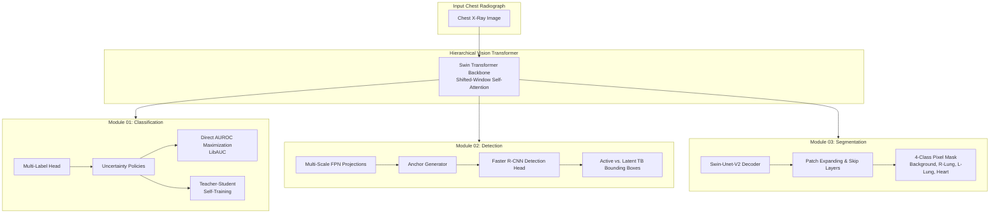
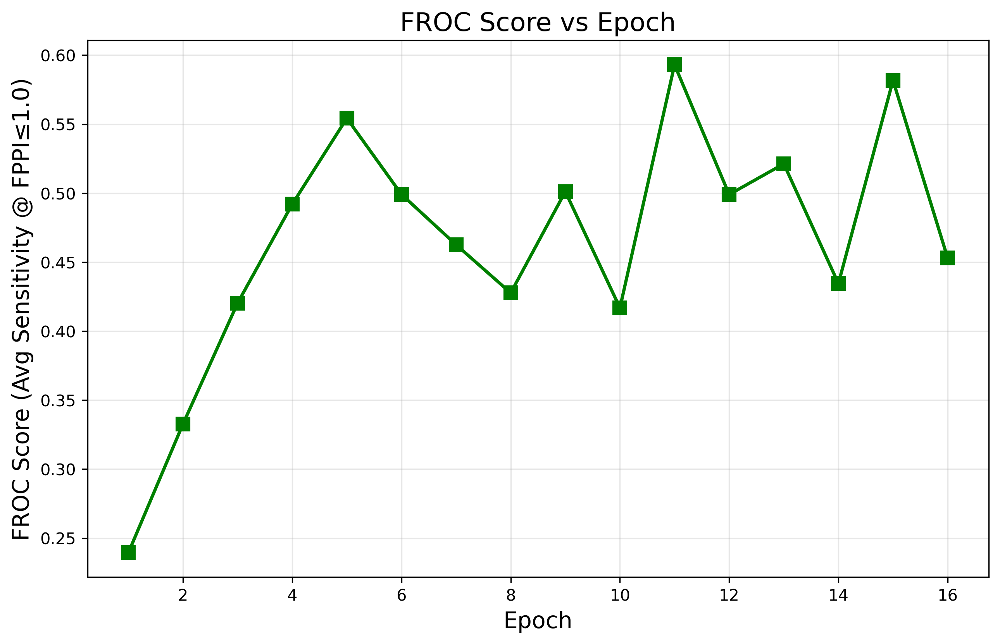
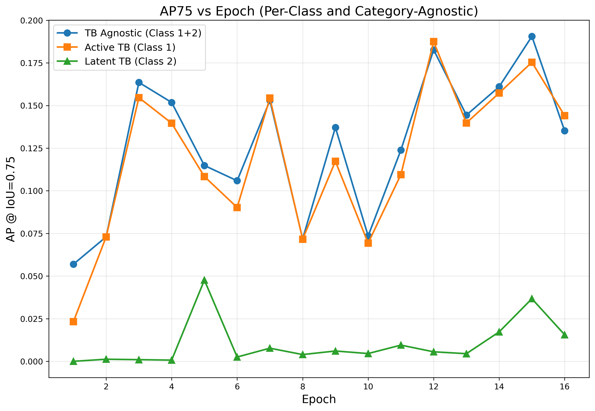
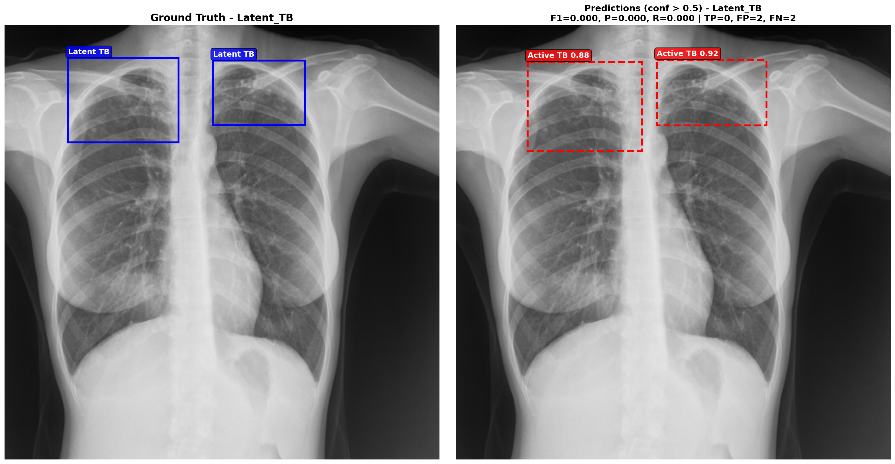

# Swin-CXR-Suite: Deep Vision Transformers for Chest Radiograph Analysis

[](https://pytorch.org/)
[](https://github.com/microsoft/Swin-Transformer)
[](LICENSE)

A unified deep learning research toolkit applying **Swin Transformer** architectures across the full spectrum of **Chest Radiograph (CXR) Computer Vision tasks**:
1. **Multi-Label Thoracic Disease Classification** ([CheXpert](https://stanfordmlgroup.github.io/competitions/chexpert/))
2. **Tuberculosis Lesion Detection & Localization** ([TBX11K](https://www.kaggle.com/datasets/usmanshams/tbx-11))
3. **Anatomical Semantic Segmentation of Lungs & Heart** ([CheXmask](https://physionet.org/content/chexmask-cxr-segmentation/0.6.3/))

Developed and scaled on Arizona State University's **Sol Supercomputer** GPU cluster.

---

## Architecture Overview



---

## Research Modules & Navigation

The repository is modularized into dedicated sub-projects, each with its own self-contained workflow and documentation:

| Directory | Task | Target Classes | Architecture | Highlights |
| :--- | :--- | :--- | :--- | :--- |
| **[`01_classification/`](./01_classification)** | Multi-Label Thoracic Pathology | 14 CheXpert Labels (5 Leaderboard) | Swin-Base (`224x224`) | Per-class uncertainty policies (reported run), teacher–student self-training, LibAUC fine-tuning script (does not run as written) |
| **[`02_detection/`](./02_detection)** | Tuberculosis Lesion Detection | Active TB, Latent TB | Swin-Base + FPN + Faster R-CNN (`512x512`) | Stratified 4-category split (`No_TB`, `Active`, `Latent`, `Mixed`), class-specific & class-agnostic AP, FROC |
| **[`03_segmentation/`](./03_segmentation)** | Anatomical Multi-Organ Segmentation | Right Lung, Left Lung, Heart | Swin-Unet-V2 | Multi-process RLE mask decoder, per-organ Dice tracking, failure case auditing |

---

## Results at a Glance

<table>
<tr>
<td align="center" width="33%"><b>CheXpert Classification</b><br><sub>Swin-B · 5 leaderboard pathologies</sub><br><br><font size="6"><b>0.9004</b></font><br>mean test AUC</td>
<td align="center" width="33%"><b>TBX11K TB Detection</b><br><sub>Faster R-CNN · Swin-B + FPN</sub><br><br><font size="6"><b>0.5930</b></font><br>FROC score (epoch 11) · AP50 <b>0.6622</b> (epoch 6)</td>
<td align="center" width="33%"><b>CheXmask Segmentation</b><br><sub>Swin-Unet-V2 · lungs + heart</sub><br><br><font size="6"><b>0.9619</b></font><br>mean test Dice</td>
</tr>
</table>

**Key findings**
- **Beats the CheXpert paper baseline:** mean AUC 0.9004 vs 0.8892 for the paper's U-Ignore model (+0.011), higher on 3 of 5 pathologies. Our run used U-Ignore for 12 of 14 classes (U-Ones for Cardiomegaly, U-Zeros for Pleural Effusion).
- **Peak AUC came early:** best epoch was epoch 2; later epochs stayed between about 0.873 and 0.892.
- **Self-training as another approach (supplementary):** students trained on the reported model's pseudo-labels for the ~139k uncertain labels reached up to 0.9028 mean AUC (confidence thresholds 0.9 / 0.1). That is a small gain over 0.9004, also picked on the test set ([details](./01_classification/README.md#another-approach-teacherstudent-self-training)).
- **Strong Active TB detection:** AP50 0.6241 (category-agnostic 0.6622), above the TBX11K leaderboard reference row (Active 62.41 vs 54.76 %, agnostic 66.22 vs 61.74 %); indicative only, custom split.
- **Latent TB is the open problem:** AP50 between 0.004 and 0.18 across epochs, with only 73 training images vs 332 for Active TB.
- **Near-perfect organ masks:** Dice 0.9616 right lung, 0.9512 left lung, 0.9494 heart. Mean Dice rose every epoch of the 11-epoch run.
- **Failure cases are unusual inputs:** the lowest-scoring test images are blank, noise-filled or non-chest views (lowest organ-mean Dice 0.42); typical hard cases (tilted patients, implanted devices) score about 0.79.

Every curve, per-epoch table (also as CSV), slide and qualitative case is in each module's `results/` folder:
[`01_classification/results`](./01_classification/results/README.md) · [`02_detection/results`](./02_detection/results/README.md) · [`03_segmentation/results`](./03_segmentation/results/README.md)

The original SLURM training and test logs behind the CheXpert and TBX11K numbers are included under `results/run_logs/`. The exact scripts of each reported run are in `01_classification/exp1_policy_training/`, `02_detection/original_run/` and `03_segmentation/original_run/`.

---

## Experimental Highlights

### 1. CheXpert Multi-Label Classification ([full results](./01_classification/results/README.md))

| Atelectasis | Cardiomegaly | Consolidation | Edema | Pleural Effusion | **Mean** |
| :---: | :---: | :---: | :---: | :---: | :---: |
| 0.8606 | 0.8697 | 0.8987 | 0.9165 | 0.9566 | **0.9004** |
| *0.818* | *0.828* | *0.938* | *0.934* | *0.928* | *0.8892* |

<sub>Row 1: Swin-B, epoch 2, test set (best epoch chosen on test AUC). Row 2 (italic): CheXpert paper U-Ignore, validation set, so the comparison is indicative only.</sub>

<p align="center">
  
  
</p>

<sub>Supplementary self-training: the best student reached 0.9028 mean AUC ([chart and details](./01_classification/README.md#another-approach-teacherstudent-self-training)).</sub>

### 2. TBX11K Tuberculosis Lesion Detection ([full results](./02_detection/results/README.md))

| Epoch | AP50 agnostic | AP50 Active | AP50 Latent | AP75 agnostic | AP75 Active | AP75 Latent | FROC |
| :--- | :---: | :---: | :---: | :---: | :---: | :---: | :---: |
| 6 (best AP50) | **0.6622** | **0.6241** | 0.0763 | 0.1059 | 0.0902 | 0.0025 | 0.4991 |
| 11 (best FROC) | 0.6449 | 0.6114 | **0.1410** | 0.1239 | 0.1095 | 0.0095 | **0.5930** |
| 15 (best AP75) | 0.6332 | 0.6016 | 0.1249 | **0.1905** | **0.1754** | **0.0367** | 0.5817 |

<p align="center">
  
  
</p>
<p align="center">
  
  
</p>

**Test-set predictions at epoch 11** (ground truth left, prediction right; red = Active TB, blue = Latent TB):

<p align="center">
  
  
</p>

<sub>Left: both Active TB lesions found (0.95, 0.68). Right: both Latent TB lesions are located correctly but labelled Active TB. That is the typical Latent TB error behind its low per-class AP. More examples: [prediction gallery](./02_detection/results/README.md#210-prediction-examples-epoch-11).</sub>

### 3. CheXmask Lung & Heart Segmentation ([full results](./03_segmentation/results/README.md))

| Background | Right Lung | Left Lung | Heart | **Mean Dice** |
| :---: | :---: | :---: | :---: | :---: |
| 0.9854 | 0.9616 | 0.9512 | 0.9494 | **0.9619** |

<p align="center">
  
  
</p>

<table>
<tr><th>Best 3 test cases (Dice 0.985–0.991)</th><th>Low-scoring cases #28–#30 of the bottom 30 (organ-mean Dice ≈ 0.79)</th></tr>
<tr>
<td></td>
<td></td>
</tr>
</table>
<sub>Columns: original, ground truth, prediction. Red = right lung, green = left lung, blue = heart. The three lowest-scoring test images (blank, noise-filled or non-chest inputs) are shown in <a href="03_segmentation/assets/best_worst_predictions_epoch_11.png">this figure</a>.</sub>

---

## Installation & Environment Setup

### 1. Clone the Repository
```bash
git clone https://github.com/smanika3/Swin-CXR-Suite.git
cd Swin-CXR-Suite
```

### 2. Create Environment
```bash
conda create -n swin_cxr python=3.10 -y
conda activate swin_cxr

# Install PyTorch matching your CUDA runtime (example CUDA 11.8):
pip install torch torchvision --index-url https://download.pytorch.org/whl/cu118

# Install suite requirements:
pip install -r requirements.txt
```

---

## Quick Execution Guide

Each module is self-contained; run its commands from inside its folder. Each module README has the dataset download, the full pipeline and the exact settings of the reported run.

```bash
# 1. CheXpert classification, reported run (edit the paths at the top of both files first)
cd 01_classification/exp1_policy_training
python v2_train_swin.py
python multi_test.py
#    Other training methods (baseline, policy mapping, self-training): see 01_classification/README.md

# 2. TBX11K detection: split, train, evaluate (AP + FROC)
cd 02_detection
python data/split_dataset.py --csv-path /path/to/tbx11k-simplified/data.csv --output-dir /path/to/tbx11k-simplified
python train.py --data-dir /path/to/tbx11k-simplified --epochs 30 --batch-size 8 --lr 1e-4
python evaluate.py --data-dir /path/to/tbx11k-simplified --checkpoint ./checkpoints/checkpoint_epoch_11.pth --split test

# 3. CheXmask segmentation: masks, 70/30 split, train, evaluate
cd 03_segmentation
python data/prep_mask.py --csv-path $CHEXMASK_CSV --train-img-dir $CHEXPERT/train --val-img-dir $CHEXPERT/valid --output-dir $MASKS --min-rca 0.7
python data/split_train_test.py --input $MASKS/train_files.txt --train-out $MASKS/train_split.txt --test-out $MASKS/test_files.txt
python train.py --img-dir $CHEXPERT/train --mask-dir $MASKS/train --train-list $MASKS/train_split.txt \
    --val-img-dir $CHEXPERT/valid --val-mask-dir $MASKS/valid --val-list $MASKS/valid_files.txt --epochs 11 --batch-size 96
python evaluate.py --img-dir $CHEXPERT/train --mask-dir $MASKS/train --test-list $MASKS/test_files.txt \
    --checkpoint ./checkpoints/checkpoint_epoch_11.pth
```

---

## Repository Structure

```text
Swin-CXR-Suite/
├── README.md                      # Master repository documentation
├── requirements.txt               # Unified project dependencies
├── .gitignore                     # Git tracking exclusions
│
├── 01_classification/             # CheXpert multi-label Vision Transformer
│   ├── exp1_policy_training/      # Reported run: per-class policy training + per-epoch test evaluation
│   ├── self_training/             # Teacher-Student pseudo-labeling (supplementary results)
│   ├── train_baseline.py          # Plain supervised Swin-B baseline (CLI)
│   ├── train_uncertainty.py       # Per-class uncertainty policy mapping (CLI)
│   ├── finetune_libauc.py         # LibAUC AUROC fine-tuning (does not run as written)
│   ├── evaluate.py                # AUROC of one checkpoint on valid.csv
│   └── results/                   # CheXpert figures, slides, CSV tables, run logs
│
├── 02_detection/                  # TBX11K Swin-FPN Faster R-CNN detection
│   ├── models/                    # SwinBackboneWithFPN & Faster R-CNN
│   ├── data/                      # CSV dataset loader & 4-category stratified splits
│   ├── train.py                   # AdamW training loop
│   ├── evaluate.py                # Class-specific / class-agnostic AP and FROC
│   ├── visualize.py               # Ground Truth vs Prediction visualizer
│   ├── original_run/              # Exact scripts of the reported run
│   └── results/                   # TBX11K figures, slides, CSV tables, run logs
│
├── 03_segmentation/               # CheXmask multi-organ semantic segmentation
│   ├── models/                    # Swin-Unet-V2 architecture definitions
│   ├── data/                      # RLE mask decoding (RCA filter) and 70/30 split
│   ├── analysis/                  # Failure mode and worst-case auditor
│   ├── train.py                   # CrossEntropy training loop, Dice metric
│   ├── evaluate.py                # Organ-wise Dice score evaluation
│   ├── original_run/              # Exact scripts of the reported run
│   └── results/                   # CheXmask figures, slides, CSV tables
│
└── LICENSE                        # MIT
```

---

## Citation & References

```bibtex
@article{liu2021swin,
  title={Swin Transformer: Hierarchical Vision Transformer using Shifted Windows},
  author={Liu, Ze and Lin, Yutong and Cao, Yue and Hu, Han and Wei, Yixuan and Zhang, Zheng and Lin, Stephen and Guo, Baining},
  journal={ICCV},
  year={2021}
}

@article{cao2022swin,
  title={Swin-Unet: Unet-Like Pure Transformer for Medical Image Segmentation},
  author={Cao, Hu and Wang, Yueyue and Chen, Joy and Jiang, Dongsheng and Zhang, Xiaopeng and Tian, Qi and Wang, Manning},
  journal={ECCV},
  year={2022}
}

@inproceedings{yuan2021robust,
  title={Robust Deep AUC Maximization: A New Surrogate Loss and Empirical Studies on Medical Image Classification},
  author={Yuan, Zhuoning and Yan, Yan and Sonka, Milan and Yang, Tianbao},
  booktitle={ACM SIGKDD},
  year={2021}
}
```
