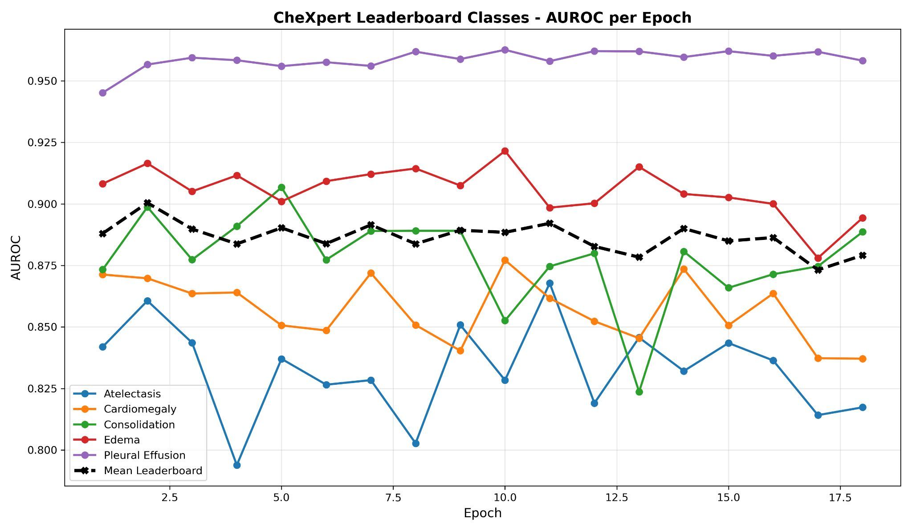
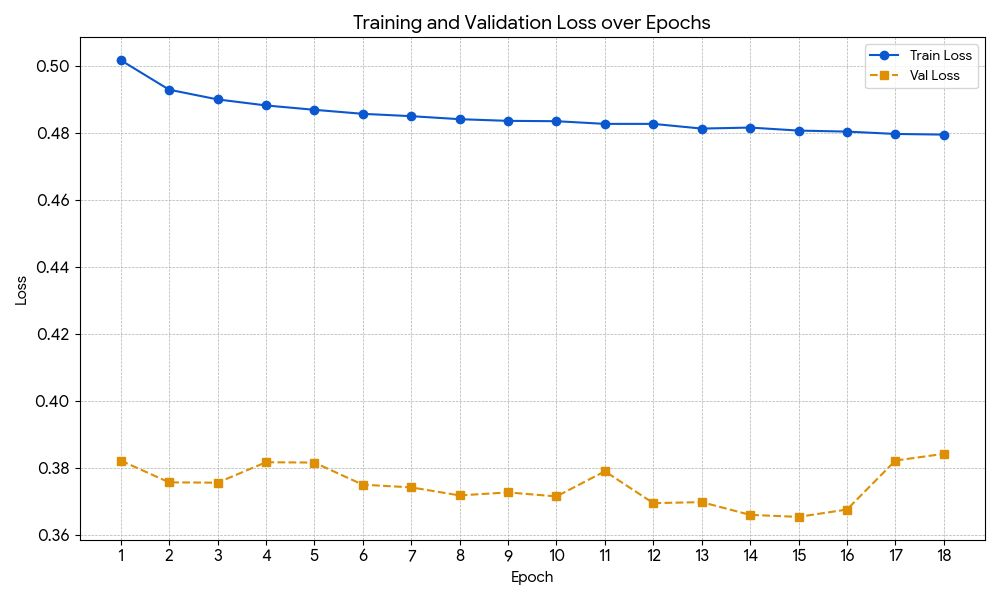
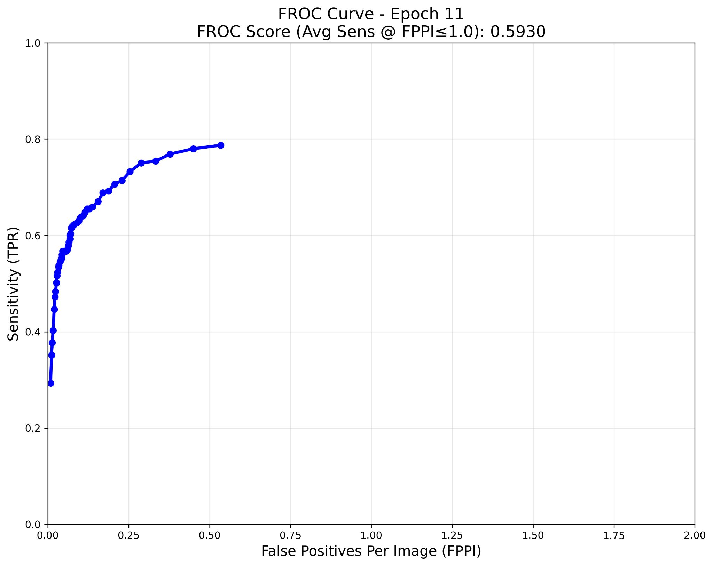
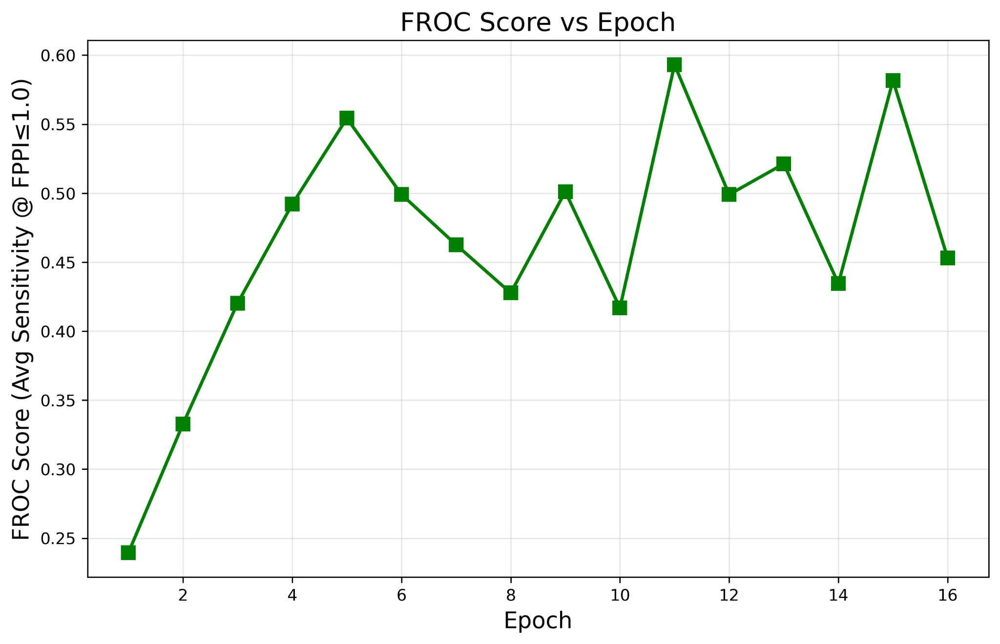
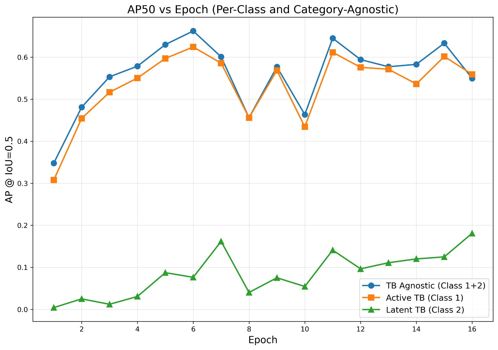
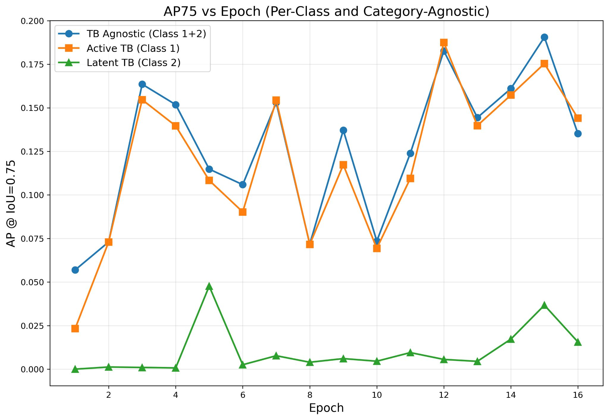
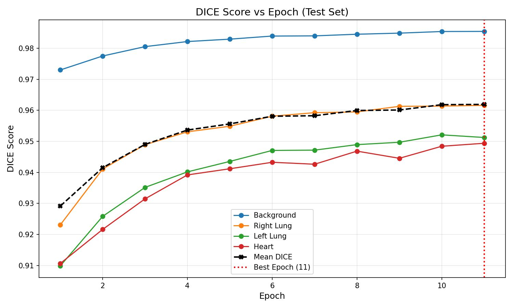
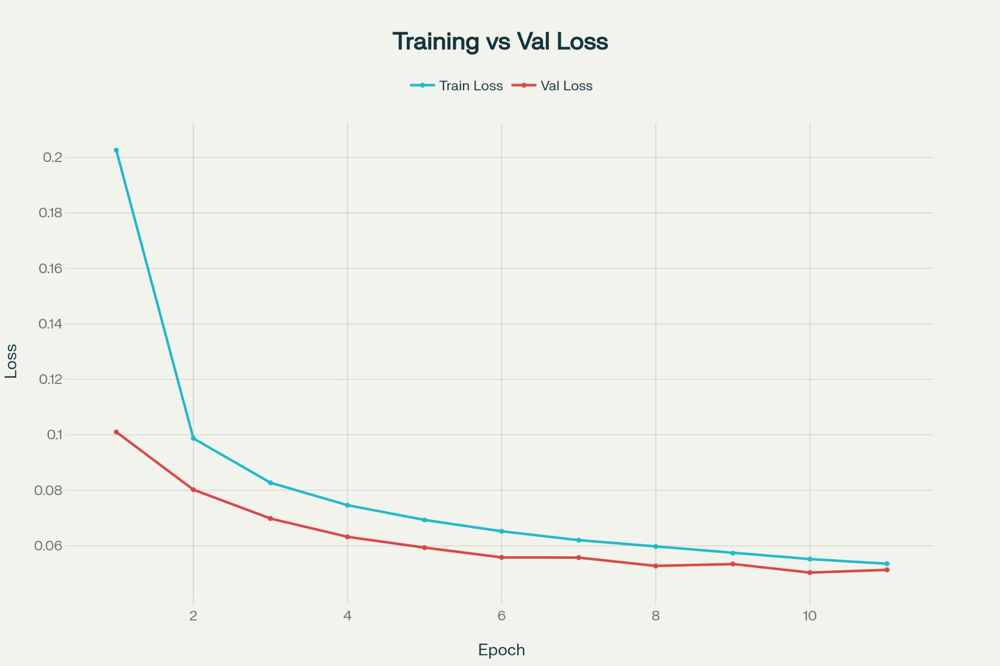
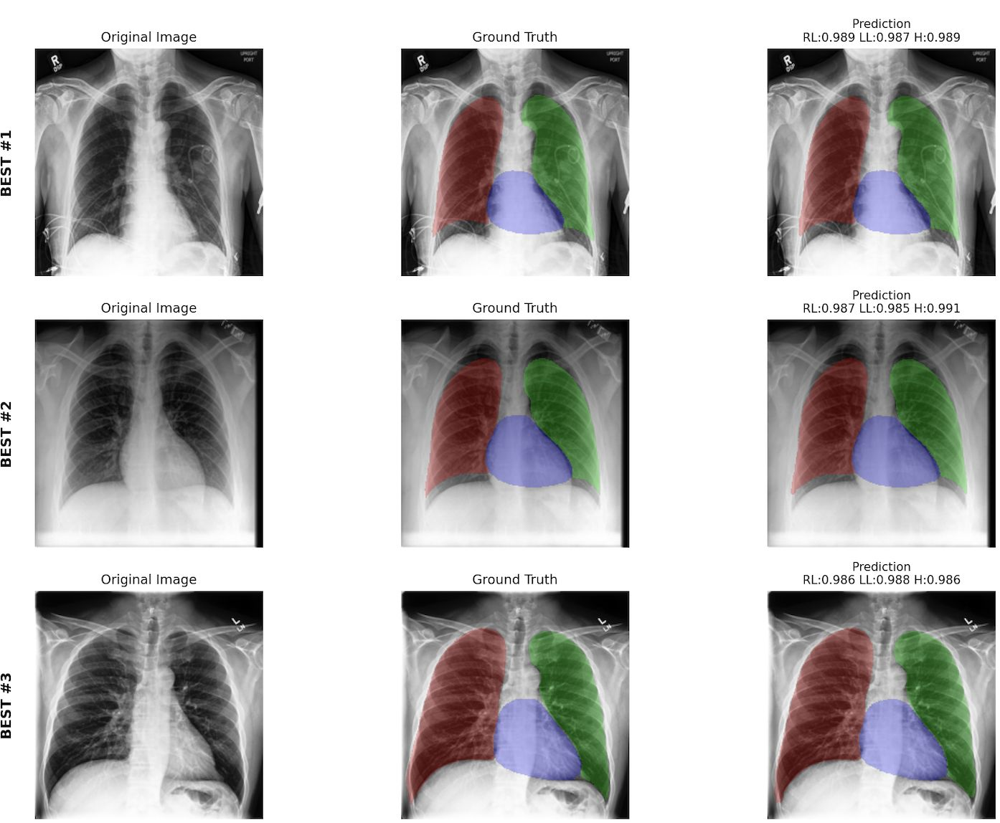
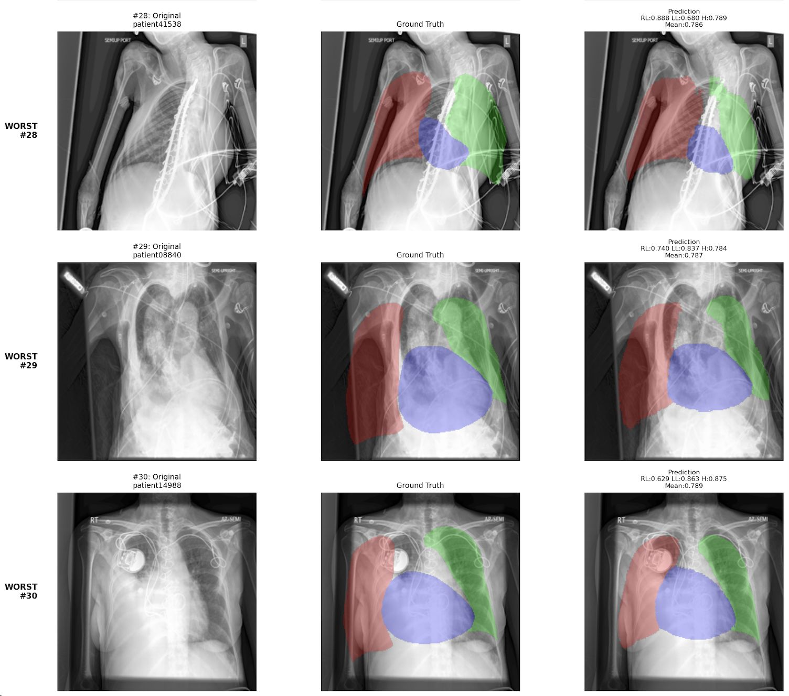

# Swin-CXR-Suite: Deep Vision Transformers for Chest Radiograph Analysis

[](https://pytorch.org/)
[](https://github.com/microsoft/Swin-Transformer)
[](LICENSE)

A unified deep learning research toolkit applying **Swin Transformer** architectures across the full spectrum of **Chest Radiograph (CXR) Computer Vision tasks**:
1. **Multi-Label Thoracic Disease Classification** ([CheXpert](https://stanfordmlgroup.github.io/competitions/chexpert/))
2. **Tuberculosis Lesion Detection & Localization** ([TBX11K](https://www.kaggle.com/datasets/usmanshams/tbx-11))
3. **Anatomical Semantic Segmentation of Lungs & Heart** ([CheXmask](https://physionet.org/content/chexmask-cxr-segmentation/0.6.3/))

Developed and scaled on Arizona State University's **Sol Supercomputer** GPU cluster.

---

## Architecture Overview


---

## Research Modules & Navigation

The repository is modularized into dedicated sub-projects, each with its own self-contained workflow and documentation:

| Directory | Task | Target Classes | Architecture | Highlights |
| :--- | :--- | :--- | :--- | :--- |
| **[`01_classification/`](./01_classification)** | Multi-Label Thoracic Pathology | 14 CheXpert Labels (5 Leaderboard) | Swin-Base (`224x224`) | U-Ones/U-Zeros policies, LibAUC surrogate AUROC loss, pseudo-label distillation |
| **[`02_detection/`](./02_detection)** | Tuberculosis Bounding Box Detection | Active TB vs. Obsolete TB | Swin-Base + Custom FPN + Faster R-CNN | Pure PyTorch / Torchvision implementation, standard COCO mAP & clinical FROC metrics |
| **[`03_segmentation/`](./03_segmentation)** | Anatomical Multi-Organ Segmentation | Right Lung, Left Lung, Heart | Swin-Unet-V2 | Multi-process RLE mask decoder, per-organ Dice tracking, failure case auditing |
| **[`04_localization_tabular/`](./04_localization_tabular)** | TB Lesion Localization (Tabular) | Active TB, Latent TB, Normal | Swin-FPN Faster R-CNN (`512x512`) | Stratified 4-category splitting (`No_TB`, `Active`, `Latent`, `Mixed`), class-agnostic AP |
| **[`05_detection_mmdet/`](./05_detection_mmdet)** | Detection Benchmarking (MMDetection) | Active TB, Obsolete TB | Swin-B Mask/Faster R-CNN | OpenMMLab MMDetection configurations and benchmark scripts |

---

## Results at a Glance

<table>
<tr>
<td align="center" width="33%"><b>CheXpert Classification</b><br><sub>Swin-B · 5 leaderboard pathologies</sub><br><br><font size="6"><b>0.9004</b></font><br>mean test AUC</td>
<td align="center" width="33%"><b>TBX11K TB Detection</b><br><sub>Faster R-CNN · Swin-B + FPN</sub><br><br><font size="6"><b>0.5930</b></font><br>FROC score · AP50 <b>0.6622</b></td>
<td align="center" width="33%"><b>CheXmask Segmentation</b><br><sub>Swin-Unet-V2 · lungs + heart</sub><br><br><font size="6"><b>0.9619</b></font><br>mean test Dice</td>
</tr>
</table>

**Key findings**
- **Beats the CheXpert paper baseline:** mean AUC 0.9004 vs 0.8892 for the paper's U-Ignore model (+0.011), higher on 3 of 5 pathologies.
- **Peak AUC came early:** best epoch was epoch 2; later epochs stayed between about 0.873 and 0.892.
- **Strong Active TB detection:** AP50 0.6241 (category-agnostic 0.6622), above the TBX11K leaderboard reference row (Active 62.41 vs 54.76 %, agnostic 66.22 vs 61.74 %); indicative only, custom split.
- **Latent TB is the open problem:** AP50 at most 0.14, with only 73 training images vs 332 for Active TB.
- **Near-perfect organ masks:** Dice 0.9616 right lung, 0.9512 left lung, 0.9494 heart. Dice rose every epoch of the 11-epoch run.
- **Graceful failure:** even the worst test cases (tilted patients, implanted devices) keep a mean Dice of about 0.79.

Every curve, per-epoch table (also as CSV), slide and qualitative case is in each module's `results/` folder:
[`01_classification/results`](./01_classification/results/README.md) · [`02_detection/results`](./02_detection/results/README.md) · [`03_segmentation/results`](./03_segmentation/results/README.md)

---

## Experimental Highlights

### 1. CheXpert Multi-Label Classification ([full results](./01_classification/results/README.md))

| Atelectasis | Cardiomegaly | Consolidation | Edema | Pleural Effusion | **Mean** |
| :---: | :---: | :---: | :---: | :---: | :---: |
| 0.8606 | 0.8697 | 0.8987 | 0.9165 | 0.9566 | **0.9004** |
| *0.818* | *0.828* | *0.938* | *0.934* | *0.928* | *0.8892* |

<sub>Row 1: Swin-B, epoch 2, test set. Row 2 (italic): CheXpert paper U-Ignore, validation set, so the comparison is indicative only.</sub>

<p align="center">
  
  
</p>

### 2. TBX11K Tuberculosis Lesion Detection ([full results](./02_detection/results/README.md))

| Epoch | AP50 agnostic | AP50 Active | AP50 Latent | AP75 agnostic | AP75 Active | AP75 Latent | FROC |
| :--- | :---: | :---: | :---: | :---: | :---: | :---: | :---: |
| 6 (best AP50) | **0.6622** | **0.6241** | 0.0763 | 0.1059 | 0.0902 | 0.0025 | 0.4991 |
| 11 (best FROC) | 0.6449 | 0.6114 | **0.1410** | 0.1239 | 0.1095 | 0.0095 | **0.5930** |
| 15 (best AP75) | 0.6332 | 0.6016 | 0.1249 | **0.1905** | **0.1754** | **0.0367** | 0.5817 |

<p align="center">
  
  
</p>
<p align="center">
  
  
</p>

### 3. CheXmask Lung & Heart Segmentation ([full results](./03_segmentation/results/README.md))

| Background | Right Lung | Left Lung | Heart | **Mean Dice** |
| :---: | :---: | :---: | :---: | :---: |
| 0.9854 | 0.9616 | 0.9512 | 0.9494 | **0.9619** |

<p align="center">
  
  
</p>

<table>
<tr><th>Best 3 test cases (Dice 0.985–0.991)</th><th>Worst 3 test cases (mean Dice ≈ 0.79)</th></tr>
<tr>
<td></td>
<td></td>
</tr>
</table>
<sub>Columns: original, ground truth, prediction. Red = right lung, green = left lung, blue = heart.</sub>

---

## Installation & Environment Setup

### 1. Clone the Repository
```bash
git clone https://github.com/smanika3/Swin-CXR-Suite.git
cd Swin-CXR-Suite
```

### 2. Create Environment
```bash
conda create -n swin_cxr python=3.9 -y
conda activate swin_cxr

# Install PyTorch matching your CUDA runtime (example CUDA 11.8):
pip install torch torchvision --index-url https://download.pytorch.org/whl/cu118

# Install suite requirements:
pip install -r requirements.txt
```

---

## Quick Execution Guide

Each module can be executed independently from root or from within its subdirectory:

```bash
# 1. Run CheXpert multi-label classification training
python 01_classification/train_baseline.py --data-dir /path/to/chexpert

# 2. Run TBX11K native Faster R-CNN detection training
python 02_detection/train.py --data-dir /path/to/tbx11k

# 3. Run CheXmask Swin-Unet segmentation training
python 03_segmentation/train.py \
    --img-dir /path/to/chexpert \
    --mask-dir /path/to/chexmask-masks \
    --train-list /path/to/train_files.txt \
    --val-list /path/to/val_files.txt

# 4. Run TBX11K stratified tabular localization training
python 04_localization_tabular/train.py --data-dir /path/to/tbx11k-simplified
```

---

## Repository Structure

```text
Swin-CXR-Suite/
├── README.md                      # Master repository documentation
├── requirements.txt               # Unified project dependencies
├── .gitignore                     # Git tracking exclusions
│
├── 01_classification/             # CheXpert multi-label Vision Transformer
│   ├── self_training/             # Teacher-Student pseudo-labeling distillation
│   ├── train_baseline.py          # Supervised Swin-B training
│   ├── train_uncertainty.py       # Clinical uncertainty policies
│   ├── finetune_libauc.py         # Direct AUROC surrogate optimization
│   ├── evaluate.py                # Multi-label AUROC evaluator
│   └── results/                   # CheXpert figures, slides, CSV tables
│
├── 02_detection/                  # TBX11K native Faster R-CNN detection
│   ├── models/                    # SwinBackboneFPN implementation
│   ├── datasets/                  # COCO dataset loader & collate
│   ├── tools/                     # Raw TBX11K to COCO converter
│   ├── train.py                   # PyTorch training loop
│   ├── evaluate.py                # COCO mAP and FROC evaluation
│   ├── visualize.py               # Ground Truth vs Prediction visualizer
│   └── results/                   # TBX11K figures, slides, CSV tables
│
├── 03_segmentation/               # CheXmask multi-organ semantic segmentation
│   ├── models/                    # Swin-Unet-V2 architecture definitions
│   ├── data/                      # High-throughput RLE mask decoding tool
│   ├── analysis/                  # Failure mode and worst-case auditor
│   ├── train.py                   # Dice & CrossEntropy segmentation loop
│   ├── evaluate.py                # Organ-wise Dice score evaluation
│   └── results/                   # CheXmask figures, slides, CSV tables
│
├── 04_localization_tabular/       # TBX11K stratified tabular localization
│   ├── models/                    # SwinBackboneWithFPN & Faster R-CNN
│   ├── data/                      # 4-category stratified split generator
│   ├── train.py                   # Training pipeline
│   ├── evaluate.py                # Class-specific and class-agnostic AP
│   └── visualize.py               # Side-by-side visualizer
│
├── 05_detection_mmdet/            # MMDetection TBX11K benchmark configs
│   ├── configs/                   # MMDetection Swin-B configs
│   └── tools/                     # Conversion and training helpers
│
└── LICENSE                        # MIT
```

---

## Citation & References

```bibtex
@article{liu2021swin,
  title={Swin Transformer: Hierarchical Vision Transformer using Shifted Windows},
  author={Liu, Ze and Lin, Yutong and Cao, Yue and Hu, Han and Wei, Yixuan and Zhang, Zheng and Lin, Stephen and Guo, Baining},
  journal={ICCV},
  year={2021}
}

@article{cao2022swin,
  title={Swin-Unet: Unet-Like Pure Transformer for Medical Image Segmentation},
  author={Cao, Hu and Wang, Yueyue and Chen, Joy and Jiang, Dongsheng and Zhang, Xiaopeng and Tian, Qi and Wang, Manning},
  journal={ECCV},
  year={2022}
}

@inproceedings{yuan2021robust,
  title={Robust Deep AUC Maximization: A New Surrogate Loss and Empirical Studies on Medical Image Classification},
  author={Yuan, Zhuoning and Yan, Yan and Sonka, Milan and Yang, Tianbao},
  booktitle={ACM SIGKDD},
  year={2021}
}
```
