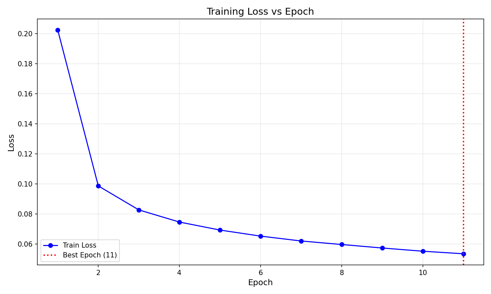
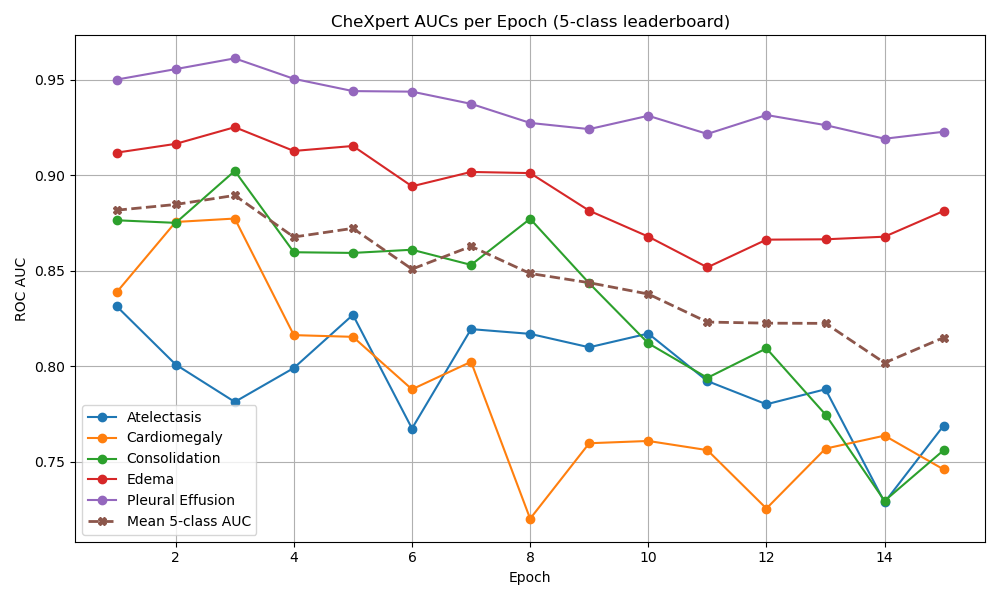

# Swin-CXR-Suite: Deep Vision Transformers for Chest Radiograph Analysis

[](https://pytorch.org/)
[](https://github.com/microsoft/Swin-Transformer)
[](LICENSE)

A unified deep learning research toolkit applying **Swin Transformer** architectures across the full spectrum of **Chest Radiograph (CXR) Computer Vision tasks**:
1. **Multi-Label Thoracic Disease Classification** ([CheXpert](https://stanfordmlgroup.github.io/competitions/chexpert/))
2. **Tuberculosis Lesion Detection & Localization** ([TBX11K](https://www.kaggle.com/datasets/usmanshams/tbx-11))
3. **Anatomical Semantic Segmentation of Lungs & Heart** ([CheXmask](https://physionet.org/content/chexmask-cxr-segmentation/0.6.3/))

Developed and scaled on Arizona State University's **Sol Supercomputer** GPU cluster.

---

## Architecture Overview


---

## Research Modules & Navigation

The repository is modularized into dedicated sub-projects, each with its own self-contained workflow and documentation:

| Directory | Task | Target Classes | Architecture | Highlights |
| :--- | :--- | :--- | :--- | :--- |
| **[`01_classification/`](./01_classification)** | Multi-Label Thoracic Pathology | 14 CheXpert Labels (5 Leaderboard) | Swin-Base (`224x224`) | U-Ones/U-Zeros policies, LibAUC surrogate AUROC loss, pseudo-label distillation |
| **[`02_detection/`](./02_detection)** | Tuberculosis Bounding Box Detection | Active TB vs. Obsolete TB | Swin-Base + Custom FPN + Faster R-CNN | Pure PyTorch / Torchvision implementation, standard COCO mAP & clinical FROC metrics |
| **[`03_segmentation/`](./03_segmentation)** | Anatomical Multi-Organ Segmentation | Right Lung, Left Lung, Heart | Swin-Unet-V2 | Multi-process RLE mask decoder, per-organ Dice tracking, failure case auditing |
| **[`04_localization_tabular/`](./04_localization_tabular)** | TB Lesion Localization (Tabular) | Active TB, Latent TB, Normal | Swin-FPN Faster R-CNN (`512x512`) | Stratified 4-category splitting (`No_TB`, `Active`, `Latent`, `Mixed`), class-agnostic AP |
| **[`05_detection_mmdet/`](./05_detection_mmdet)** | Detection Benchmarking (MMDetection) | Active TB, Obsolete TB | Swin-B Mask/Faster R-CNN | OpenMMLab MMDetection configurations and benchmark scripts |

---

## Experimental Highlights & Visualizations

### 1. Multi-Organ Segmentation Convergence (CheXmask)
<p align="center">
  
  
</p>

### 2. Qualitative Mask Segmentation Outputs
<p align="center">
  
</p>

### 3. Classification AUROC Training Traces (CheXpert)
<p align="center">
  
</p>

---

## Benchmark Performance Summary

> *Note: Quantitative tables below represent our core validation results. Detailed checkpoint metrics and logs can be reviewed in each module.*

### Classification Performance (CheXpert Validation Set)
| Pathology | Baseline Swin AUROC | Uncertainty-Guided AUROC | LibAUC Fine-Tuned AUROC |
| :--- | :--- | :--- | :--- |
| **Atelectasis** | *Pending / Custom* | *Pending / Custom* | *Pending / Custom* |
| **Cardiomegaly** | *Pending / Custom* | *Pending / Custom* | *Pending / Custom* |
| **Consolidation** | *Pending / Custom* | *Pending / Custom* | *Pending / Custom* |
| **Edema** | *Pending / Custom* | *Pending / Custom* | *Pending / Custom* |
| **Pleural Effusion** | *Pending / Custom* | *Pending / Custom* | *Pending / Custom* |
| **Leaderboard Mean** | **-** | **-** | **-** |

### Lesion Detection Performance (TBX11K Test Set)
| Method | Backbone | mAP@[.5:.95] | AP50 | AP75 | FROC Score (0.5–8 FPPI) |
| :--- | :--- | :--- | :--- | :--- | :--- |
| **Native Faster R-CNN (`02_detection`)** | Swin-Base FPN | *Pending* | *Pending* | *Pending* | *Pending* |
| **Stratified Pipeline (`04_localization`)** | Swin-FPN | *Pending* | *Pending* | *Pending* | *Pending* |

### Semantic Segmentation Performance (CheXmask Test Set)
| Anatomical Structure | Dice Similarity Coefficient (DSC) | IoU / Jaccard Index |
| :--- | :--- | :--- |
| **Right Lung** | ~0.96+ | ~0.92+ |
| **Left Lung** | ~0.95+ | ~0.91+ |
| **Heart** | ~0.90+ | ~0.83+ |
| **Mean Organ Average** | **~0.94+** | **~0.89+** |

---

## Installation & Environment Setup

### 1. Clone the Repository
```bash
git clone https://github.com/<your-username>/swin-cxr-suite.git
cd swin-cxr-suite
```

### 2. Create Environment
```bash
conda create -n swin_cxr python=3.9 -y
conda activate swin_cxr

# Install PyTorch matching your CUDA runtime (example CUDA 11.8):
pip install torch torchvision --index-url https://download.pytorch.org/whl/cu118

# Install suite requirements:
pip install -r requirements.txt
```

---

## Quick Execution Guide

Each module can be executed independently from root or from within its subdirectory:

```bash
# 1. Run CheXpert multi-label classification training
python 01_classification/train_baseline.py --data-dir /path/to/chexpert

# 2. Run TBX11K native Faster R-CNN detection training
python 02_detection/train.py --data-dir /path/to/tbx11k

# 3. Run CheXmask Swin-Unet segmentation training
python 03_segmentation/train.py \
    --img-dir /path/to/chexpert \
    --mask-dir /path/to/chexmask-masks \
    --train-list /path/to/train_files.txt \
    --val-list /path/to/val_files.txt

# 4. Run TBX11K stratified tabular localization training
python 04_localization_tabular/train.py --data-dir /path/to/tbx11k-simplified
```

---

## Repository Structure

```text
swin-cxr-suite/
├── README.md                      # Master repository documentation
├── requirements.txt               # Unified project dependencies
├── .gitignore                     # Git tracking exclusions
│
├── 01_classification/             # CheXpert multi-label Vision Transformer
│   ├── self_training/             # Teacher-Student pseudo-labeling distillation
│   ├── train_baseline.py          # Supervised Swin-B training
│   ├── train_uncertainty.py       # Clinical uncertainty policies
│   ├── finetune_libauc.py         # Direct AUROC surrogate optimization
│   └── evaluate.py                # Multi-label AUROC evaluator
│
├── 02_detection/                  # TBX11K native Faster R-CNN detection
│   ├── models/                    # SwinBackboneFPN implementation
│   ├── datasets/                  # COCO dataset loader & collate
│   ├── tools/                     # Raw TBX11K to COCO converter
│   ├── train.py                   # PyTorch training loop
│   ├── evaluate.py                # COCO mAP and FROC evaluation
│   └── visualize.py               # Ground Truth vs Prediction visualizer
│
├── 03_segmentation/               # CheXmask multi-organ semantic segmentation
│   ├── models/                    # Swin-Unet-V2 architecture definitions
│   ├── data/                      # High-throughput RLE mask decoding tool
│   ├── analysis/                  # Failure mode and worst-case auditor
│   ├── train.py                   # Dice & CrossEntropy segmentation loop
│   └── evaluate.py                # Organ-wise Dice score evaluation
│
├── 04_localization_tabular/       # TBX11K stratified tabular localization
│   ├── models/                    # SwinBackboneWithFPN & Faster R-CNN
│   ├── data/                      # 4-category stratified split generator
│   ├── train.py                   # Training pipeline
│   ├── evaluate.py                # Class-specific and class-agnostic AP
│   └── visualize.py               # Side-by-side visualizer
│
├── 05_detection_mmdet/            # MMDetection TBX11K benchmark configs
│   ├── configs/                   # MMDetection Swin-B configs
│   └── tools/                     # Conversion and training helpers
│
└── assets/                        # Research figures, training curves & outputs
```

---

## Citation & References

```bibtex
@article{liu2021swin,
  title={Swin Transformer: Hierarchical Vision Transformer using Shifted Windows},
  author={Liu, Ze and Lin, Yutong and Cao, Yue and Hu, Han and Wei, Yixuan and Zhang, Zheng and Lin, Stephen and Guo, Baining},
  journal={ICCV},
  year={2021}
}

@article{cao2022swin,
  title={Swin-Unet: Unet-Like Pure Transformer for Medical Image Segmentation},
  author={Cao, Hu and Wang, Yueyue and Chen, Joy and Jiang, Dongsheng and Zhang, Xiaopeng and Tian, Qi and Wang, Manning},
  journal={ECCV},
  year={2022}
}

@inproceedings{yuan2021robust,
  title={Robust Deep AUC Maximization: A New Surrogate Loss and Empirical Studies on Medical Image Classification},
  author={Yuan, Zhuoning and Yan, Yan and Sonka, Milan and Yang, Tianbao},
  booktitle={ACM SIGKDD},
  year={2021}
}
```
