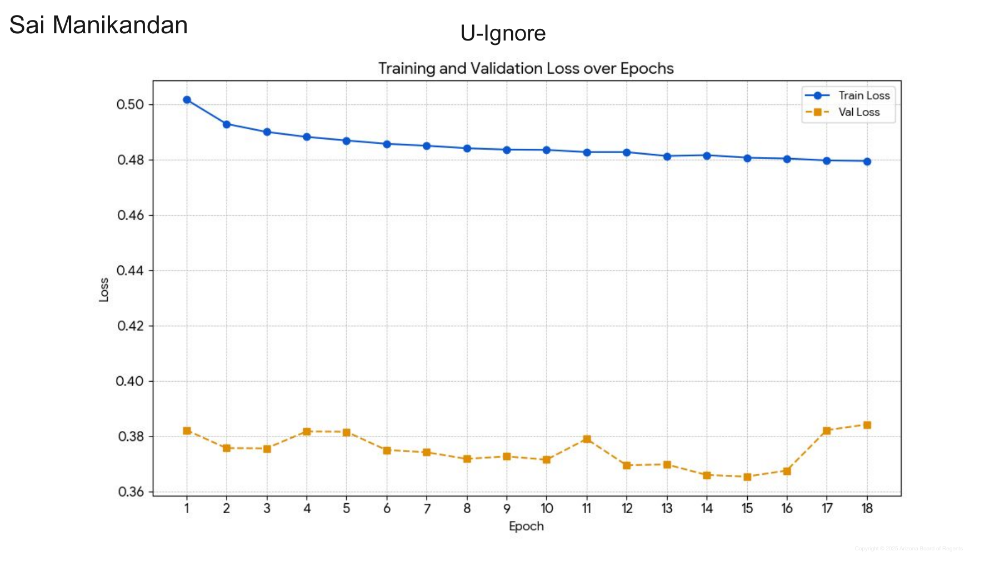
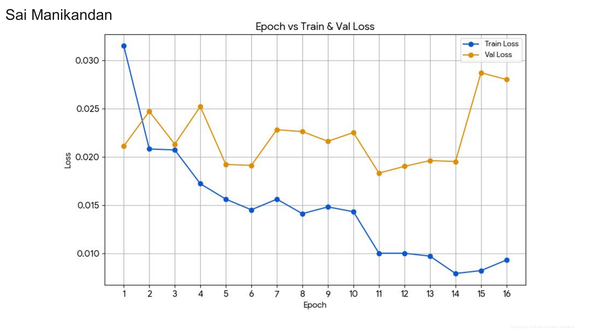
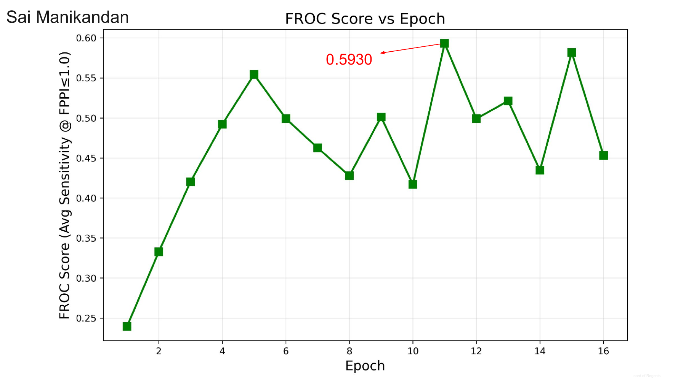
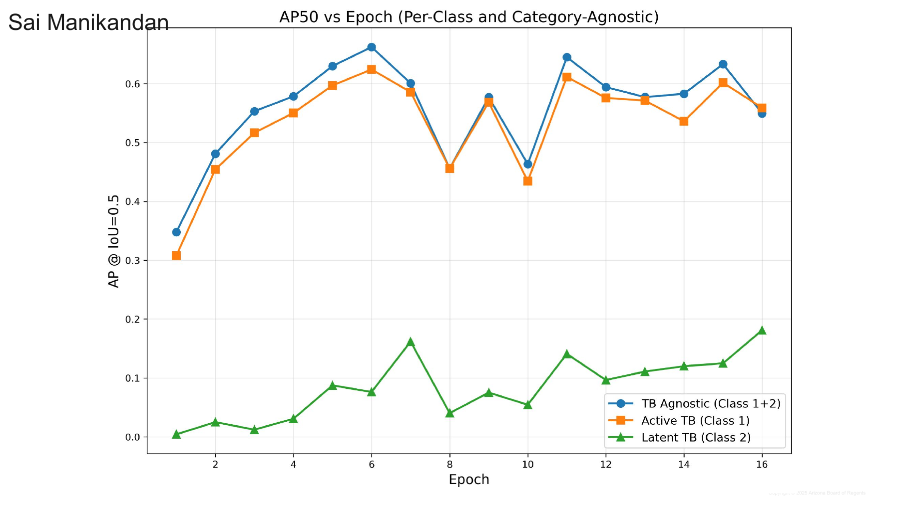
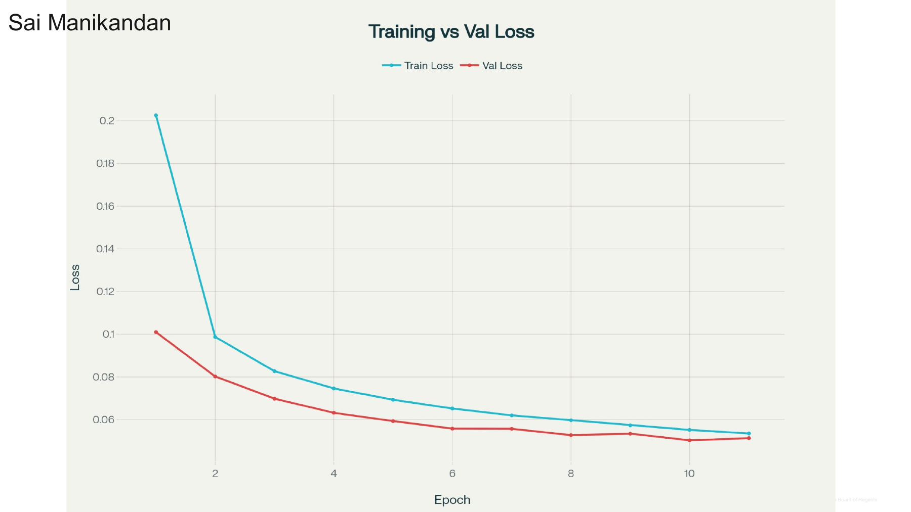
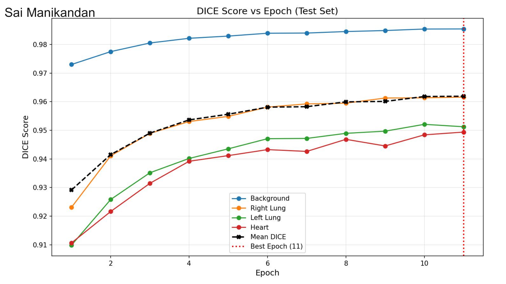
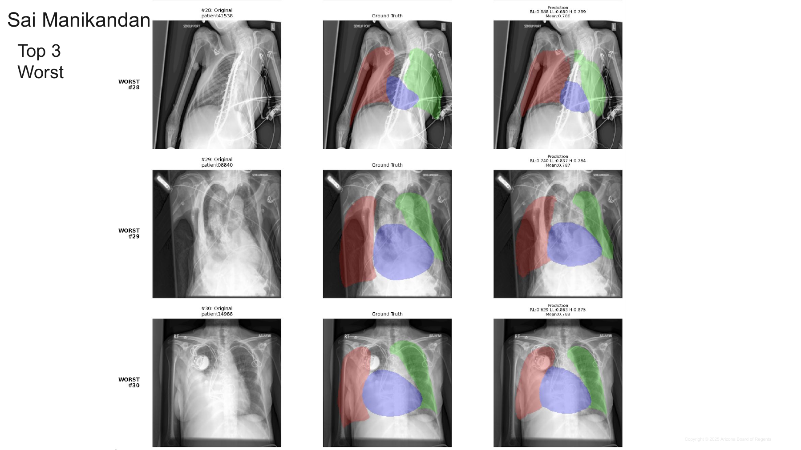

# Deep Learning Training Results — Sai Manikandan

Results extracted from the *Final Presentation* (116 slides). Only the slides carrying the name **Sai Manikandan** are included.
Graphs, tables and prediction images come straight from the presentation; every table is also provided as a CSV in
[`tables/`](tables/). Statements marked *Observation* are my own reading of a chart or table, not something the slide says.

## Contents

| # | Experiment | Task | Model | Headline result | Slides |
|---|---|---|---|---|---|
| 1 | [CheXpert](#1-swin-transformer-on-chexpert) | Multi-label chest X-ray classification | Swin-B (ImageNet-1K) | Mean AUC **0.9004** (epoch 2) | 14–21 |
| 2 | [TBX11K](#2-swin--faster-r-cnn-on-tbx11k) | Tuberculosis lesion detection | Faster R-CNN, Swin-B + FPN backbone | FROC score **0.5930** (epoch 11) | 55–64 |
| 3 | [CheXmask (CheXpert)](#3-swin-u-net-v2-on-chexmask) | Lung and heart segmentation | Swin Transformer U-Net V2 | Mean Dice **0.9619** (epoch 11) | 84–94 |

The deck's cross-team summary slides (34, 70, 116) list these same three numbers next to teammates' results for other backbones.

**Metric reminders:** AUC and Dice are better when higher; loss is better when lower. AP50 / AP75 = average precision at box-overlap (IoU)
0.5 / 0.75. FROC score = average sensitivity at up to 1 false positive per image (FPPI).

**Folder layout**

```
README.md
images/slides/    full slides rendered as PNG (180 dpi), exactly as in the deck, with the name label
images/figures/   the original graphs / images embedded in the slides (JPEG, no slide overlay)
tables/           every results table as CSV
```

---

## 1. Swin Transformer on CheXpert

*Multi-label chest X-ray classification — slides 14–21*

### Setup (slides 15–16)

| Item | Value |
|---|---|
| Task | Multi-label classification of all 14 CheXpert pathologies; mean and per-class AUC reported on the 5 leaderboard pathologies (Atelectasis, Cardiomegaly, Consolidation, Edema, Pleural Effusion) |
| Data | Train 223,414 · validation 234 · test 668 |
| Model | Swin Transformer Base (`swin_base_patch4_window7_224`), ImageNet-1K pretrained, 224×224 input, 14 output logits |
| Training | BCEWithLogitsLoss · AdamW (weight decay 0.1) · learning rate 1e-4 · 18 epochs, best epoch picked by AUC |
| Uncertain labels | U-Ignore (uncertain labels ignored) |
| Best result | Mean 5-class test AUC **0.9004** at epoch 2 |

Slide images: [task & dataset](images/slides/slide015_exp1_setup_task_dataset.png) · [model & training](images/slides/slide016_exp1_setup_model_training.png)

**Summary.** The model hit its best mean leaderboard AUC (0.9004) at epoch 2, then stayed between about 0.873 and 0.892 for the remaining
16 epochs. Pleural Effusion is the easiest class (0.945–0.963); Atelectasis is the hardest and least stable (0.794–0.868). Against the
original CheXpert paper's U-Ignore numbers, Swin is higher on mean AUC (+0.011) and on 3 of 5 classes.

### 1.1 Training and validation loss (slide 17)



*Original figure: [`exp1_loss_curve.jpg`](images/figures/exp1_loss_curve.jpg)*

- Training loss falls steadily from 0.5016 (epoch 1) to 0.4794 (epoch 18).
- Validation loss is flat-to-noisy: lowest 0.3654 (epoch 15), highest 0.3842 (epoch 18), rising at epochs 17–18.
- *Observation:* the lowest validation loss (epoch 15) is not the best-AUC epoch (epoch 2). The checkpoint was selected on AUC, not loss.

### 1.2 Loss table (slide 18)

| Epoch | Train loss | Val loss |
|---|---|---|
| 1 | 0.5016 | 0.3822 |
| 2 | 0.4928 | 0.3757 |
| 3 | 0.4899 | 0.3756 |
| 4 | 0.4881 | 0.3817 |
| 5 | 0.4868 | 0.3816 |
| 6 | 0.4856 | 0.375 |
| 7 | 0.4849 | 0.3742 |
| 8 | 0.484 | 0.3718 |
| 9 | 0.4835 | 0.3727 |
| 10 | 0.4834 | 0.3715 |
| 11 | 0.4826 | 0.379 |
| 12 | 0.4826 | 0.3695 |
| 13 | 0.4812 | 0.3698 |
| 14 | 0.4815 | 0.366 |
| 15 | 0.4806 | 0.3654 |
| 16 | 0.4803 | 0.3676 |
| 17 | 0.4796 | 0.3822 |
| 18 | 0.4794 | 0.3842 |

CSV: [`exp1_chexpert_loss.csv`](tables/exp1_chexpert_loss.csv) · slide: [PNG](images/slides/slide018_exp1_loss_table.png)

### 1.3 Per-class AUROC across epochs (slide 19)


*Original figure (without the "AUC = 0.9004" annotation): [`exp1_auroc_per_epoch.jpg`](images/figures/exp1_auroc_per_epoch.jpg)*

- Pleural Effusion (purple) is at the top, about 0.96 for nearly every epoch after epoch 2.
- Atelectasis and Consolidation swing the most (Atelectasis 0.7938 at epoch 4; Consolidation 0.8236 at epoch 13) and drive the movement in the mean.
- The mean line is almost flat after the epoch-2 peak (0.9004), so extra epochs gave no net gain.

### 1.4 Per-class AUC table (slide 20)

| Epoch | Cardiomegaly | Edema | Consolidation | Atelectasis | Pleural Effusion | Mean leaderboard AUC |
|---|---|---|---|---|---|---|
| 1 | 0.8713 | 0.9082 | 0.8733 | 0.8419 | 0.9452 | 0.8880 |
| **2** | **0.8697** | **0.9165** | **0.8987** | **0.8606** | **0.9566** | **0.9004** |
| 3 | 0.8636 | 0.9051 | 0.8773 | 0.8436 | 0.9594 | 0.8898 |
| 4 | 0.8640 | 0.9116 | 0.8909 | 0.7938 | 0.9584 | 0.8837 |
| 5 | 0.8506 | 0.9010 | 0.9067 | 0.8370 | 0.9560 | 0.8903 |
| 6 | 0.8486 | 0.9092 | 0.8773 | 0.8265 | 0.9576 | 0.8838 |
| 7 | 0.8719 | 0.9121 | 0.8890 | 0.8284 | 0.9561 | 0.8915 |
| 8 | 0.8508 | 0.9144 | 0.8891 | 0.8027 | 0.9619 | 0.8838 |
| 9 | 0.8403 | 0.9075 | 0.8891 | 0.8508 | 0.9589 | 0.8893 |
| 10 | 0.8771 | 0.9215 | 0.8525 | 0.8284 | 0.9626 | 0.8884 |
| 11 | 0.8617 | 0.8985 | 0.8746 | 0.8678 | 0.9580 | 0.8921 |
| 12 | 0.8523 | 0.9003 | 0.8799 | 0.8190 | 0.9621 | 0.8827 |
| 13 | 0.8454 | 0.9150 | 0.8236 | 0.8457 | 0.9620 | 0.8783 |
| 14 | 0.8735 | 0.9040 | 0.8807 | 0.8321 | 0.9597 | 0.8900 |
| 15 | 0.8507 | 0.9026 | 0.8659 | 0.8435 | 0.9621 | 0.8849 |
| 16 | 0.8636 | 0.9000 | 0.8714 | 0.8364 | 0.9602 | 0.8863 |
| 17 | 0.8373 | 0.8780 | 0.8746 | 0.8141 | 0.9618 | 0.8732 |
| 18 | 0.8371 | 0.8943 | 0.8886 | 0.8173 | 0.9582 | 0.8791 |

CSV: [`exp1_chexpert_auc_per_epoch.csv`](tables/exp1_chexpert_auc_per_epoch.csv) · slide: [PNG](images/slides/slide020_exp1_auc_table.png)

- Best epoch overall is **epoch 2** (mean 0.9004).
- Per-class peaks in the table: Cardiomegaly 0.8771 (epoch 10), Edema 0.9215 (epoch 10), Consolidation 0.9067 (epoch 5), Atelectasis 0.8678 (epoch 11), Pleural Effusion 0.9626 (epoch 10).
- *Observation:* the slide's green highlight for Edema is on epoch 2 (0.9165), but Edema is higher at epoch 10 (0.9215), so the highlights do not mark every per-class maximum.
- No single epoch is best for every class; the best mean is a compromise across classes.

### 1.5 Comparison with the CheXpert paper and leaderboard (slide 21)


| Method / epoch | Atelectasis | Cardiomegaly | Consolidation | Edema | Pleural Effusion | Mean AUC |
|---|---|---|---|---|---|---|
| U-Ignore (paper, validation AUC) | 0.818 | 0.828 | 0.938 | 0.934 | 0.928 | 0.8892 |
| Swin, epoch 2 (test AUC) | 0.8606 | 0.8697 | 0.8987 | 0.9165 | 0.9566 | 0.9004 |

CSV: [`exp1_chexpert_paper_vs_swin.csv`](tables/exp1_chexpert_paper_vs_swin.csv)

Leaderboard rows shown on the slide for reference: top entry *DeepAUC-v1 ensemble*, AUC 0.930 ([image](images/figures/exp1_leaderboard_top_entry.jpg)); rank 86 *DS_APR_N* single model, AUC 0.911 ([image](images/figures/exp1_leaderboard_rank86_entry.jpg)).

- Swin beats the paper on Atelectasis (+0.043), Cardiomegaly (+0.042), Pleural Effusion (+0.029) and mean AUC (+0.0112).
- The paper is higher on Consolidation (0.938 vs 0.8987) and Edema (0.934 vs 0.9165).
- The leaderboard entries (0.930, 0.911) are still above 0.9004.
- *Caveat:* the slide compares the paper's **validation** AUC with Swin's **test** AUC, so the comparison is indicative, not like-for-like.

---

## 2. Swin + Faster R-CNN on TBX11K

*Tuberculosis lesion detection — slides 55–64*

### Setup (slides 56–57)

| Item | Value |
|---|---|
| Task | Object detection (localisation) of tuberculosis lesions in chest X-rays; images fall in 4 categories: No_TB, Active_TB, Latent_TB, Mixed_TB |
| Split | Stratified split; minimum quotas for rare classes in the test set (at least 20 Latent_TB and 5 Mixed_TB). Train 4,622 · Val 1,800 · Test 1,977 |
| Model | Faster R-CNN, Swin Base backbone (ImageNet pretrained, features from stages 1–3), FPN with 256 output channels |
| RPN | Anchor sizes 32/64/128/256 px; aspect ratios 0.5/1.0/2.0 |
| Heads / input | 3 classes (background, Active TB, Latent TB); images resized to 512×512 |
| Training | AdamW · learning rate 1e-4 · batch size 8 · multi-task loss (RPN classification + regression, ROI classification + regression) · 30 epochs listed on slide 57 (result slides report 16) |
| Thresholds | Training proposal 0.05 · inference confidence 0.5 · IoU 0.5 |
| Best result | FROC score **0.5930** at epoch 11 |

Dataset split by category (slide 56):

| Category | Total | Train | Test |
|---|---|---|---|
| No_TB | 6000 | 4200 (70.0%) | 1800 (30.0%) |
| Active_TB | 473 | 332 (70.2%) | 141 (29.8%) |
| Latent_TB | 103 | 73 (70.9%) | 30 (29.1%) |
| Mixed_TB | 23 | 17 (73.9%) | 6 (26.1%) |

Slide images: [task & dataset](images/slides/slide056_exp2_setup_task_dataset.png) · [model & training](images/slides/slide057_exp2_setup_model_training.png)

**Summary.** The detector localises **Active TB** well (AP50 about 0.60–0.62 at its best epochs) but struggles with **Latent TB**
(AP50 only 0.08–0.14 at the three standout epochs, AP75 near zero), the rare class. Metrics peak at different epochs: AP50 at epoch 6,
FROC at epoch 11, AP75 at epoch 15. Epoch 11 is the headline because it has the best FROC score. Validation loss rises after epoch 14, a sign of overfitting.

### 2.1 Training and validation loss (slide 58)



*Original figure: [`exp2_loss_curve.jpg`](images/figures/exp2_loss_curve.jpg)*

- Training loss falls from 0.0315 to about 0.008–0.009, with a visible drop at epoch 11.
- Validation loss is noisy and lowest at epoch 11 (0.0183), then jumps to 0.0287 (epoch 15) and 0.028 (epoch 16).
- *Observation:* training loss keeps improving while validation loss worsens at the end, i.e. overfitting after epoch 14.

### 2.2 Loss table (slide 59)

| Epoch | Train loss | Val loss |
|---|---|---|
| 1 | 0.0315 | 0.0211 |
| 2 | 0.0208 | 0.0247 |
| 3 | 0.0207 | 0.0213 |
| 4 | 0.0172 | 0.0252 |
| 5 | 0.0156 | 0.0192 |
| 6 | 0.0145 | 0.0191 |
| 7 | 0.0156 | 0.0228 |
| 8 | 0.0141 | 0.0226 |
| 9 | 0.0148 | 0.0216 |
| 10 | 0.0143 | 0.0225 |
| **11** | **0.01** | **0.0183** |
| 12 | 0.01 | 0.019 |
| 13 | 0.0097 | 0.0196 |
| 14 | 0.0079 | 0.0195 |
| 15 | 0.0082 | 0.0287 |
| 16 | 0.0093 | 0.028 |

Epoch 11 (bold; highlighted yellow on the slide) has the lowest validation loss. CSV: [`exp2_tbx11k_loss.csv`](tables/exp2_tbx11k_loss.csv) · slide: [PNG](images/slides/slide059_exp2_loss_table.png)

### 2.3 FROC score vs epoch (slide 60)



*Original figure: [`exp2_froc_vs_epoch.jpg`](images/figures/exp2_froc_vs_epoch.jpg)*

- FROC rises from 0.24 (epoch 1) to about 0.55 by epoch 5, then oscillates between roughly 0.42 and 0.59.
- Best: **0.5930 at epoch 11**; second best 0.5817 at epoch 15.
- The large epoch-to-epoch swings mean no single epoch should be read as a stable level.

### 2.4 FROC curve at the best epoch (slide 61)


*Original figure: [`exp2_froc_curve_epoch11.jpg`](images/figures/exp2_froc_curve_epoch11.jpg)*

- Sensitivity climbs steeply at low false-positive rates: about 0.6 at roughly 0.07 FPPI and about 0.75 at roughly 0.3 FPPI (read from the chart).
- The plotted curve ends at about 0.79 sensitivity near 0.53 FPPI; the x-axis extends to 2.0 but no points are plotted beyond that.
- FROC score = average sensitivity up to FPPI 1.0 = **0.5930**.

### 2.5 AP50 vs epoch (slide 62)



*Original figure: [`exp2_ap50_vs_epoch.jpg`](images/figures/exp2_ap50_vs_epoch.jpg)*

- Category-agnostic and Active TB track each other and peak at epoch 6 (0.6622 and 0.6241), with sharp dips at epochs 8 and 10.
- Latent TB stays far lower (0.004–0.18 across epochs; 0.0763 at epoch 6, 0.1410 at epoch 11), trending up late in training.
- *Observation:* the Active-vs-Latent gap is the main weakness. Latent TB has only 73 training images vs 332 for Active TB (slide 56).

### 2.6 AP75 vs epoch (slide 63)


*Original figure: [`exp2_ap75_vs_epoch.jpg`](images/figures/exp2_ap75_vs_epoch.jpg)*

- AP75 is much lower than AP50 (best about 0.19 vs 0.66): objects are found but boxes are often not tightly placed.
- Category-agnostic AP75 peaks at epoch 15 (0.1905); Active TB peaks around epoch 12 (about 0.19) and is 0.1754 at epoch 15.
- Latent TB AP75 is close to zero throughout (max about 0.047 at epoch 5).

### 2.7 Metric comparison at the best epochs (slide 64)


| Epoch | AP50 TB-agnostic | AP50 Active TB | AP50 Latent TB | AP75 TB-agnostic | AP75 Active TB | AP75 Latent TB | FROC score | Best AP50 | Best AP75 | Best FROC |
|---|---|---|---|---|---|---|---|---|---|---|
| 6 | 0.6622 | 0.6241 | 0.0763 | 0.1059 | 0.0902 | 0.0025 | 0.4991 | yes |  |  |
| **11** | **0.6449** | **0.6114** | **0.1410** | **0.1239** | **0.1095** | **0.0095** | **0.5930** |  |  | **yes** |
| 15 | 0.6332 | 0.6016 | 0.1249 | 0.1905 | 0.1754 | 0.0367 | 0.5817 |  | yes |  |

CSV: [`exp2_tbx11k_metrics_best_epochs.csv`](tables/exp2_tbx11k_metrics_best_epochs.csv)

Leaderboard reference row shown on the slide (TBX11K Tuberculosis Detection, values in %; [image](images/figures/exp2_leaderboard_reference.jpg)):

| Reference (leaderboard row on slide 64) | Cat-agnostic AP50 | Cat-agnostic AP75 | Cat-agnostic AP | Active AP50 | Active AP75 | Active AP | Latent AP50 | Latent AP75 | Latent AP |
|---|---|---|---|---|---|---|---|---|---|
| alitariq (rank 1, 16 entries, 11/09/21) | 61.74 | 19.64 | 27.32 | 54.76 | 19.49 | 25.69 | 11.77 | 0.67 | 3.52 |

- **Epoch 6** is best for AP50 (agnostic 0.6622, Active 0.6241, Latent 0.0763; FROC 0.4991).
- **Epoch 11** is best for FROC: 0.5930.
- **Epoch 15** is best for AP75 (agnostic 0.1905, Active 0.1754, Latent 0.0367; FROC 0.5817).
- *Observation:* in percent, the epoch-6 AP50 values (66.22 agnostic, 62.41 Active) are above the leaderboard row (61.74, 54.76), epoch-11 Latent AP50 (14.10) is above 11.77, and epoch-15 agnostic AP75 (19.05) is just below 19.64. This is indicative only: the slide uses a custom train/test split, not the official benchmark split.

---

## 3. Swin U-Net V2 on CheXmask

*Lung and heart segmentation (CheXpert images) — slides 84–94*

### Setup (slides 85–88)

| Item | Value |
|---|---|
| Task | 4-class segmentation: background, right lung, left lung, heart |
| Data | CheXmask annotations on the CheXpert train set (~186,592 images; masks filtered with RCA for quality). Custom patient-independent 70/30 split (scikit-learn, `random_state=42`): train 130,614 · test 55,978. Validation: 199 images from the original CheXpert validation set |
| Preprocessing | RLE-compressed masks decoded to PNG at 224×224; grayscale X-rays resized to 224×224 |
| Model | Swin Transformer U-Net V2: hierarchical Swin encoder with a U-Net-style decoder and skip connections. `img_size=224`, `num_classes=4`, `depths=[2,2,2,2]`, `depths_decoder=[1,2,2,2]`, `drop_path_rate=0.1` |
| Training | AdamW · learning rate 1e-4 · weight decay 0.05 · CrossEntropyLoss |
| Best result | Mean Dice **0.9619** at epoch 11 (background 0.9854, right lung 0.9616, left lung 0.9512, heart 0.9494) |

Slide images: [dataset](images/slides/slide085_exp3_setup_dataset.png) · [preprocessing](images/slides/slide086_exp3_setup_preprocessing.png) · [model](images/slides/slide087_exp3_setup_model.png) · [training](images/slides/slide088_exp3_setup_training.png)

**Summary.** Segmentation improved every epoch of the 11-epoch run, finishing at mean Dice 0.9619. Background is near-perfect (0.9854), then
right lung (0.9616), with left lung (0.9512) and heart (0.9494) slightly harder. The best three test images match ground truth almost exactly
(per-class Dice 0.985–0.991); the worst three (mean Dice about 0.79) are unusual images (my reading of the images).

### 3.1 Training and validation loss (slide 89)



*Original figure: [`exp3_loss_curve.jpg`](images/figures/exp3_loss_curve.jpg)*

- Training loss drops from 0.2026 to 0.0535 (largest gain in the first two epochs); validation loss from 0.101 to 0.0513.
- Validation loss stays below training loss throughout; the curves do not diverge.
- *Observation:* both are still edging down at epoch 11, so the model had not clearly converged when training stopped.

### 3.2 Loss table (slide 90)

| Epoch | Train loss | Validation loss |
|---|---|---|
| 1 | 0.2026 | 0.101 |
| 2 | 0.0987 | 0.0802 |
| 3 | 0.0827 | 0.0698 |
| 4 | 0.0746 | 0.0632 |
| 5 | 0.0693 | 0.0593 |
| 6 | 0.0652 | 0.0558 |
| 7 | 0.062 | 0.0557 |
| 8 | 0.0597 | 0.0527 |
| 9 | 0.0573 | 0.0534 |
| 10 | 0.0552 | 0.0503 |
| **11** | **0.0535** | **0.0513** |

Validation loss is lowest at epoch 10 (0.0503) and essentially level at epoch 11 (0.0513). CSV: [`exp3_chexmask_loss.csv`](tables/exp3_chexmask_loss.csv) · slide: [PNG](images/slides/slide090_exp3_loss_table.png)

### 3.3 Dice score vs epoch, test set (slide 91)



*Original figure: [`exp3_dice_vs_epoch.jpg`](images/figures/exp3_dice_vs_epoch.jpg)*

- All curves rise and flatten; mean Dice goes from 0.9292 (epoch 1) to 0.9619 (epoch 11, marked by the red dotted line).
- Ordering is stable: background > right lung > left lung > heart.
- Gains per epoch shrink to 0.0001–0.0017 over the last four epochs: slowing, not stopped.

### 3.4 Dice table (slide 92)

| Epoch | Background | Right lung | Left lung | Heart | Mean Dice |
|---|---|---|---|---|---|
| 1 | 0.9730 | 0.9231 | 0.9099 | 0.9107 | 0.9292 |
| 2 | 0.9775 | 0.9411 | 0.9258 | 0.9216 | 0.9415 |
| 3 | 0.9805 | 0.9489 | 0.9352 | 0.9315 | 0.9490 |
| 4 | 0.9822 | 0.9531 | 0.9402 | 0.9392 | 0.9536 |
| 5 | 0.9829 | 0.9549 | 0.9435 | 0.9412 | 0.9556 |
| 6 | 0.9839 | 0.9581 | 0.9471 | 0.9433 | 0.9581 |
| 7 | 0.9840 | 0.9592 | 0.9472 | 0.9426 | 0.9583 |
| 8 | 0.9845 | 0.9595 | 0.9489 | 0.9468 | 0.9599 |
| 9 | 0.9849 | 0.9613 | 0.9497 | 0.9445 | 0.9601 |
| 10 | 0.9854 | 0.9614 | 0.9521 | 0.9484 | 0.9618 |
| **11** | **0.9854** | **0.9616** | **0.9512** | **0.9494** | **0.9619** |

Improvement from epoch 1 to 11: heart +0.0387, left lung +0.0413, right lung +0.0385, background +0.0124 (it started high).
CSV: [`exp3_chexmask_dice_per_epoch.csv`](tables/exp3_chexmask_dice_per_epoch.csv) · slide: [PNG](images/slides/slide092_exp3_dice_table.png)

### 3.5 Qualitative results — three best test cases (slide 93)


*Full-resolution figure (no slide label): [`exp3_best_cases.jpg`](images/figures/exp3_best_cases.jpg)*

Columns: original, ground truth, prediction. Colours: red = right lung, green = left lung, blue = heart. Dice per class is printed above each prediction.

- Best #1: RL 0.989, LL 0.987, H 0.989 · Best #2: 0.987 / 0.985 / 0.991 · Best #3: 0.986 / 0.988 / 0.986.
- Predictions are visually almost identical to ground truth on clear, well-positioned X-rays.

### 3.6 Qualitative results — three worst test cases (slide 94)



*Full-resolution figure (no slide label): [`exp3_worst_cases.jpg`](images/figures/exp3_worst_cases.jpg)*

| Case | Right lung Dice | Left lung Dice | Heart Dice | Mean Dice | Note |
|---|---|---|---|---|---|
| Best #1 | 0.989 | 0.987 | 0.989 |  |  |
| Best #2 | 0.987 | 0.985 | 0.991 |  |  |
| Best #3 | 0.986 | 0.988 | 0.986 |  |  |
| Worst #28 | 0.888 | 0.68 | 0.789 | 0.786 | patient 41538 |
| Worst #29 | 0.74 | 0.837 | 0.784 | 0.787 | patient 08840 |
| Worst #30 | 0.629 | 0.863 | 0.875 | 0.789 | patient 14988 |

CSV: [`exp3_chexmask_qualitative_cases.csv`](tables/exp3_chexmask_qualitative_cases.csv)

- *Observation:* these are atypical images — a tilted patient with arm and tubes in view (#28), a heavily opacified chest with lines and devices (#29), and an implanted device over the right lung (#30). All three still reach a mean Dice near 0.79, so the model degrades on hard cases rather than failing outright. The slide itself gives no causes; these are read from the images.

---

*Source: "Final Presentation" (Arizona Board of Regents, 2025). Tables were transcribed from the slide text and cross-checked against the rendered slides; the images are the slides themselves or the figures embedded in them.*
